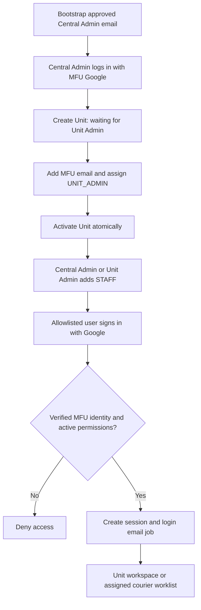

# Google Login, Login Email และ Central User

วันที่: 2026-11-06 (Asia/Bangkok)  
สถานะ: ข้อกำหนดเพิ่มเติมตามคำขอเจ้าของงาน; รายละเอียด implementation ยังต้องพิสูจน์ใน P0/P1  
เอกสารหลัก: [Flowable Requirements](Document_Tracking_Flowable_Development_Requirements.md) · [Development Plan / Tech Stack](Development_Plan_and_Tech_Stack.md)

## 1. ขอบเขตและที่มาจากระบบอ้างอิง

ใช้ Google OAuth 2.0 / OpenID Connect เป็นวิธี login เพียงช่องทางเดียว อนุญาตเฉพาะอีเมล `@mfu.ac.th` ที่ถูกเพิ่มสิทธิ์ในระบบแล้ว ส่งอีเมลแจ้งเตือนเจ้าของบัญชีเมื่อ login สำเร็จ และมีผู้ดูแลระบบกลางเพิ่ม Unit และผู้ใช้หน่วยงาน

ตรวจโค้ดใน `D:\git\DOCTRACKING` ณ HEAD `6b9f18b` วันที่ข้างต้น โดยยึดโค้ดปัจจุบันเป็นหลัก เพราะ README และเอกสาร migration บางส่วนยังอธิบายระบบรหัสผ่านเดิม:

| แหล่งอ้างอิงภายใน DOCTRACKING | พฤติกรรมที่นำมาใช้ |
|---|---|
| `ิbackend/src/auth.ts`, `google.ts`, `identity.ts` | Redirect authorization-code flow, state/nonce/PKCE, ID-token verification, exact MFU domain, allowlist และผูก Google sub ครั้งแรก |
| `ิbackend/src/core.ts`, `app.ts` | ตรวจ user/unit/session version ทุก request, regenerate/revoke session, cookie/CSRF และปิด password endpoints |
| `ิbackend/src/organization.ts` | ADMIN สร้าง Unit/UNIT_ADMIN/STAFF; UNIT_ADMIN จัดการเฉพาะ STAFF ของตน; หน่วยงานใหม่รอ Admin; ป้องกันลบ Admin หน่วยงานคนสุดท้าย |
| `ิbackend/src/setup.ts`, `db/migrations/007_google_identity.sql` | Bootstrap Admin กลางแบบ idempotent, unique Google sub และไม่แจก app password |
| `frontend/src/auth-pages.tsx`, `settings-pages.tsx` | หน้า Google login, จัดการ Unit, ผู้ใช้/บทบาท และสถานะรอผูก Google/ผูกแล้ว/ปิดใช้ |

**ข้อกำหนดใหม่:** ใน login path ของโค้ดอ้างอิงที่ตรวจยังไม่พบการส่งอีเมลแจ้งเตือน login สำเร็จ ต้องพัฒนาเพิ่มในระบบ Flowable นี้ ไม่ใช่ความสามารถที่ยืนยันว่ามีอยู่แล้วใน DOCTRACKING เดิม นำพฤติกรรมมาออกแบบบน Spring Security ไม่คัดลอก NestJS/React stack มาเพิ่ม

## 2. Google login และบัญชีที่มีสิทธิ์

1. หน้า login มีปุ่ม “เข้าสู่ระบบด้วย Google” และข้อความ “ใช้บัญชี @mfu.ac.th ที่ผู้ดูแลเพิ่มสิทธิ์ไว้แล้ว”; ไม่มีสมัครเอง/ตั้งรหัส/ลืมรหัส/รหัสผ่านสำรองของแอป
2. Backend ใช้ authorization-code flow + PKCE S256; scope เริ่มต้น `openid email`; ใช้ชื่อแสดงที่ Admin กำหนด ไม่ขอ Gmail/Drive scope เพื่อส่งอีเมลแจ้งเตือน
3. OAuth transaction ต้องผูกกับ browser session, มี state/nonce, อายุสั้น และ consume ได้ครั้งเดียว รวม callback พร้อมกันหรือ replay; ใช้ Spring Security ที่รองรับ flow นี้และเพิ่ม policy guards ของแอป
4. ตรวจ signature, issuer, audience, expiry และ nonce ของ ID token ผ่าน OIDC library; ตรวจ `email_verified=true`, `sub` ไม่ว่าง, email domain เท่ากับ `mfu.ac.th` และ `hd` ตรง hosted-domain policy ที่ยืนยันกับ MFU
5. Normalize email ด้วย trim/lowercase และตรวจ email format เต็มก่อนเทียบ domain แบบ exact; `@gmail.com`, subdomain หรือ `@mfu.ac.th.example.com` เข้าไม่ได้; `hd` ใน authorization URL เป็นเพียง hint ไม่ใช่ authorization guard
6. ต้องพบ user ที่ Admin เพิ่มไว้ เปิดใช้ และมี membership/สิทธิ์ที่ใช้งานได้; callback ไม่สร้าง user, Unit หรือ role อัตโนมัติ แม้เป็นอีเมล MFU จริง
7. First login ผูก `google_sub` กับ user ที่อีเมลตรงและยังไม่ผูก ด้วย row lock + unique constraint; หลังผูกแล้วห้ามเปลี่ยน sub เพราะเพียงอีเมลตรงกัน และต้องตรวจ email/domain ปัจจุบันด้วย ไม่รับ identity จาก frontend
8. สร้าง session ใหม่เมื่อสำเร็จ, ตั้ง Secure/HttpOnly/SameSite cookie, session TTL และ CSRF สำหรับคำสั่งในแอป; logout ตัด session แอป ไม่อ้างว่า logout Google ทั้ง browser
9. ทุก authenticated request ตรวจ user active, membership/unit active, สิทธิ์ปัจจุบัน และ `session_version`; ปิดบัญชี/ย้าย unit/เปลี่ยน role ต้อง revoke sessions เดิม ไม่รอหมดอายุเอง
10. อีเมลที่ผูก Google แล้วแก้ผ่านฟอร์มผู้ใช้ทั่วไปไม่ได้ การ rename/relink ต้องเป็นขั้นตอน IT/ผู้มีสิทธิ์ที่มี audit และ revoke sessions ไม่ overwrite identity แบบเงียบ

Google เป็นผู้ยืนยันตัวตน ส่วนฐานข้อมูลของแอปเป็นผู้กำหนดสิทธิ์ ADMIN/UNIT_ADMIN/STAFF/COURIER ตาม [Google OIDC guidance](https://developers.google.com/identity/openid-connect/openid-connect) และ [Spring Security OAuth2 Login](https://docs.spring.io/spring-security/reference/servlet/oauth2/login/core.html)

## 3. Central user และผู้ใช้หน่วยงาน

“User กลาง” หมายถึงบทบาทผู้ดูแลส่วนกลางที่ login ด้วย Google ส่วนตัวของผู้มีสิทธิ์ ไม่ใช่บัญชีรหัสผ่านที่แชร์กัน

| บทบาท | สิทธิ์จัดการบัญชี/หน่วยงาน | ความสัมพันธ์กับงานเอกสาร |
|---|---|---|
| `ADMIN` — Central Admin | เพิ่ม/แก้ไข/ปิด Unit, แต่งตั้ง UNIT_ADMIN, เพิ่ม STAFF, ย้ายสมาชิก/เปลี่ยนบทบาท/ปิดบัญชีตาม guards และดู audit | ไม่จำเป็นต้องสังกัด Unit; การลงทะเบียน/รับส่งแทนหน่วยงานต้องมีสิทธิ์ธุรกิจเพิ่มอย่างชัดเจน |
| `UNIT_ADMIN` — membership role | ดูและเพิ่ม/แก้ไข/ปิด STAFF เฉพาะ Unit ตนเอง; สร้าง Unit, แต่งตั้ง ADMIN/UNIT_ADMIN หรือเพิ่มข้าม Unit ไม่ได้ | งาน Origin/Station ใช้สิทธิ์เอกสารของ Unit ตาม Model A/B |
| `STAFF` — membership role | ดูข้อมูลบัญชีตน; ไม่มีสิทธิ์จัดการผู้ใช้/Unit | ทำงาน Origin/Station ตาม scope ที่ได้รับ |
| `COURIER` / `Coordinator` | ไม่ได้รับสิทธิ์จัดการผู้ใช้เพียงเพราะเป็น courier/coordinator | เป็นสิทธิ์ธุรกิจแยก; Central Admin กำหนด courier/station scope ตาม policy เดิม |

ข้อเสนอ MVP: ผู้ใช้หน่วยงานมีหนึ่ง active unit membership ต่อคน; courier อาจมี station scopes หลายจุดตามงานเดิม โดยแยกจาก membership และ management roles การเลือก Origin/Station ขึ้นกับบทบาทของ Unit ในเรื่องนั้น ไม่ใช่ role ที่ Google ส่งมา

### การสร้าง Unit และ provision ผู้ใช้

1. Bootstrap เตรียม Central Admin จาก `BOOTSTRAP_ADMIN_EMAIL` ที่เป็น MFU และได้รับอนุมัติ ใช้คำสั่งติดตั้งที่รันซ้ำได้ ไม่คัดลอกชื่อ/อีเมล Admin จริงจาก repo อ้างอิงเป็นค่าเริ่มต้น และไม่เปิด endpoint ให้สมัครเป็น Admin
2. Central Admin สร้าง Unit ด้วย code/name ที่ไม่ซ้ำตาม policy; Unit ใหม่เริ่ม `INACTIVE / WAITING_UNIT_ADMIN`
3. Central Admin เพิ่มอีเมล MFU + ชื่อแสดง + Unit + role `UNIT_ADMIN`; บันทึก user/membership และเปิด Unit ใน transaction เดียวกันตามพฤติกรรมระบบอ้างอิง
4. Central Admin หรือ UNIT_ADMIN เพิ่ม STAFF ที่ได้รับอนุญาต; ผู้ใช้เริ่มสถานะ “รอเข้า Google ครั้งแรก” โดยยังไม่มี `google_sub` และไม่ส่งลิงก์ตั้งรหัสผ่าน
5. First Google login ที่ตรวจผ่านจึงเปลี่ยนเป็น “ผูก Google แล้ว”; ต้องแยกสถานะนี้จาก `is_active` ไม่ตีความว่าผูกแล้วเท่ากับเปิดใช้เสมอ
6. หน่วยงานที่เปิดใช้ต้องมี UNIT_ADMIN ที่เปิดใช้อย่างน้อยหนึ่งคน ห้ามลดสิทธิ์/ย้าย/ปิดคนสุดท้ายโดยไม่แต่งตั้งผู้แทน
7. ก่อนปิดบัญชี/ย้าย Unit/เปลี่ยนสิทธิ์/ปิด Unit ตรวจงานค้าง, active courier leg/reservation และ human task ที่เกี่ยวข้อง; ถ้ายังไม่มีแผนรับช่วงให้ปฏิเสธ `409` พร้อมเหตุผล ห้ามปล่อย custody หรือสร้าง Check รับส่งแทนเจ้าของเดิมโดยอัตโนมัติ
8. ตรวจสิทธิ์ใน backend แม้ยิง API ตรง เก็บ actor, before/after, reason และ server time ใน audit; ไม่ลบ user/unit ที่มีประวัติหนังสืออ้างอิง

ไม่บังคับเพิ่ม Site module จากระบบอ้างอิงเพราะคำขอรอบนี้ต้องการ Unit; หน่วยงาน (`units`) เป็นเจ้าของจุดรับส่ง (`stations.unit_id`) เสนอเริ่มหนึ่ง Unit มีหนึ่งหรือหลาย Station เพื่อไม่ผูก user membership กับชื่อ Station หรือ route step

## 4. อีเมลแจ้งเตือนเมื่อ login สำเร็จ

- ส่งถึง **อีเมล MFU ของเจ้าของบัญชีที่ login สำเร็จ** ทุกครั้งที่ออก authenticated session ใหม่ รวม Central Admin, UNIT_ADMIN, STAFF และ Courier; ไม่ส่งทุก API call/page refresh และไม่ส่งให้ผู้พยายามเข้าแต่ไม่มีสิทธิ์
- เนื้อหา: ชื่อระบบ/บัญชี, เวลา login จาก server แสดง Asia/Bangkok, บทบาท/Unit ถ้ามี และช่องทางติดต่อ IT หากไม่ได้เป็นผู้ทำรายการ อาจแสดงข้อมูล browser/IP ที่กรองแล้วเมื่อมี policy อนุญาตและ trusted-proxy configuration ถูกต้อง
- ไม่ใส่ OAuth code, token, cookie, session ID หรือรายละเอียดหนังสือในอีเมล; การแจ้งเตือนไม่ใช่ OTP/ลิงก์ยืนยัน login และไม่เป็นขั้นตอนที่ผู้ใช้ต้องกดก่อนใช้งาน
- ใช้ `spring-boot-starter-mail` / `JavaMailSender` กับ SMTP relay หรือบริการส่งเมลขององค์กร แยกจาก OAuth credentials ของผู้ใช้ ตั้ง sender, TLS, authentication และ connection/read/write timeout ตามผู้ให้บริการ ดู [Spring Boot Email](https://docs.spring.io/spring-boot/reference/io/email.html)
- เมื่อ auth ผ่านให้ finalize login ผ่าน application service: persist session + login audit + `LOGIN_SUCCEEDED` email-outbox แบบ atomic ด้วย Spring Session JDBC/DataSource/transaction manager ที่กำหนดชัด และพิสูจน์ rollback ใน P1; ไม่ enqueue จาก callback ก่อนตรวจ allowlist หรือจากจุดที่ session ยัง save ไม่สำเร็จ
- Worker อ่าน notification outbox หลัง commit และส่งนอก login request; SMTP ล่มต้องไม่ทำให้ login ที่ finalize แล้วถูกยกเลิก งานเมลต้องค้างเพื่อ retry/backoff และแจ้ง Central Admin เมื่อหมด retry; ถ้าบันทึก session/audit/outbox ไม่สำเร็จต้องไม่รายงาน login สำเร็จ
- Unique `(login_event_id, notification_type, recipient)` กัน enqueue ซ้ำ; callback replay ไม่สร้าง session/login event ใหม่ ส่วน SMTP อาจรับเมลแล้วแต่ worker ยังไม่บันทึก ACK จึงอาจส่งซ้ำได้ ให้ใช้ Message-ID คงที่และ provider idempotency ถ้ามี ไม่รับรอง exactly-once delivery ด้วย SMTP ธรรมดา
- สถานะขั้นต่ำ `PENDING`, `PROCESSING`, `RETRY_WAIT`, `ACCEPTED_BY_PROVIDER`, `FAILED`; SMTP รับแล้วไม่ได้แปลว่าผู้รับอ่านหรือรับถึง inbox เสมอ เก็บ attempts/next_retry/error ที่กรองข้อมูลแล้ว และมี lease recovery เมื่อ worker restart
- แยก notification worker/queue จาก workflow outbox ด้วย destination/type และ retry policy; ปัญหา SMTP ต้องไม่หยุดการส่ง event ไป Flowable

## 5. API และข้อมูลที่ต้องเพิ่ม

ใช้ prefix `/api/v1` ให้ตรง business API โดย configure Spring Security authorization/callback URI ตามนี้และลงทะเบียน redirect URI เดียวกันใน Google Console ไม่สมมติว่า default Spring callback ตรงกับ path นี้เอง

| Method / Endpoint | หน้าที่ / สิทธิ์ |
|---|---|
| `GET /api/v1/auth/google/start` | เริ่ม Google redirect; public + rate limit |
| `GET /api/v1/auth/google/callback` | ตรวจ OAuth/OIDC, allowlist, session finalization และสร้าง email job; ไม่รับ role/email เป็นหลักฐานจาก query |
| `GET /api/v1/auth/me` | ข้อมูลผู้ใช้และ scope ปัจจุบัน; ไม่มี raw Google credentials |
| `GET /api/v1/auth/csrf` | CSRF bootstrap ตาม session policy |
| `POST /api/v1/auth/logout` | ทำลาย session; ต้อง CSRF |
| `GET /api/v1/units` | รายการที่มองเห็นได้; Central Admin เห็น Unit ที่ยังไม่เปิดด้วย |
| `POST /api/v1/units`, `PATCH /api/v1/units/{id}` | Central Admin สร้าง/แก้/เปิดปิด Unit |
| `GET /api/v1/users` | Central Admin ตาม scope ระบบ; UNIT_ADMIN เฉพาะ Unit ตน; ไม่เปิด directory รวมให้ STAFF |
| `POST /api/v1/users`, `PATCH /api/v1/users/{id}` | Provision/edit ผู้ใช้ตาม role matrix; ไม่ใช้ฟอร์มนี้สร้าง Central Admin |
| `GET /api/v1/admin/login-notifications` | Central Admin ตรวจสถานะเมลที่ส่งไม่สำเร็จ โดยไม่เปิด token/session identifiers |
| `POST /api/v1/admin/login-notifications/{id}/retry` | Central Admin retry job เดิม; CSRF + idempotency + audit |

ข้อมูลเชิงแนวคิดที่เพิ่ม: `units`, `unit_memberships`, `users.email_normalized` (unique), `users.google_sub` (unique nullable), `users.system_role`, `users.session_version`, `email_verified_at`, `is_active`, `stations.unit_id`, application sessions และ `auth_login_events`/`notification_outbox`/`notification_delivery_attempts` ส่วน courier/station permissions และ audit เดิมยังคงใช้

## 6. Mermaid — Login และส่งอีเมล

```mermaid
sequenceDiagram
  actor U as MFU User
  participant B as Browser
  participant A as Spring Security / Backend
  participant G as Google OIDC
  participant D as PostgreSQL
  participant W as Notification Worker
  participant M as Organization Mail Relay
  U->>B: Sign in with Google
  B->>A: Start login
  A->>B: Redirect with state, nonce and PKCE
  B->>G: Choose MFU Google account
  G->>B: Redirect with authorization code
  B->>A: OAuth callback
  A->>G: Exchange code and verify ID token
  A->>D: Check MFU domain, allowlist, active user and roles
  alt Identity or permissions rejected
    A-->>B: Login denied; no session or email job
  else Login permitted
    A->>D: Atomic session, login audit and email outbox
    D-->>A: Commit
    A-->>B: Session cookie and redirect to app
    W->>D: Claim pending login notification
    W->>M: Send notification to login user's MFU email
    alt Provider accepted email
      W->>D: Record provider acceptance
    else Mail unavailable
      W->>D: Schedule retry; login remains valid
    end
  end
```

## 7. Mermaid — Central Admin เพิ่ม Unit และผู้ใช้



## 8. Acceptance และการนำไปพัฒนา

ใช้ T27–T42 ในเอกสารหลักร่วมกับ T01–T26 โดยเริ่ม auth/unit provisioning/login-email ใน P1 ก่อน business flow สาธิต และต้องผ่านการทดสอบ Google จริง + SMTP จริงบน staging ก่อน Pilot

P0 เตรียม Google Web OAuth client, exact HTTPS redirect URI, hosted-domain policy, bootstrap Admin email, sender/SMTP relay และผู้ดูแลการส่งเมล ค่า secret เก็บ backend/secret manager ไม่ใส่ frontend bundle หรือเอกสาร ไม่สร้าง credentials หรือส่งอีเมลจริงในงานอัปเดตเอกสารรอบนี้
