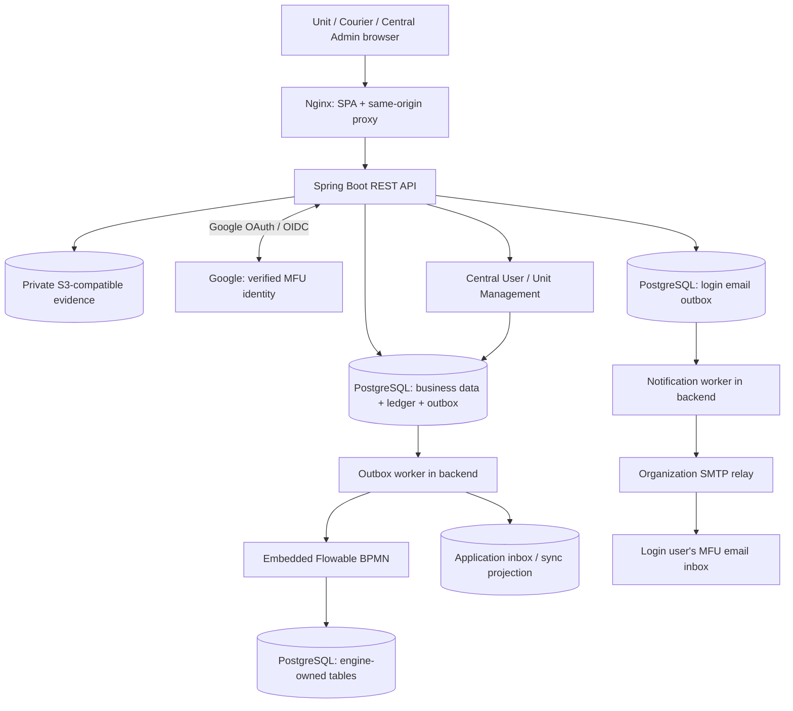

# แผนพัฒนาและ Tech Stack — Document Tracking / Flowable

วันที่: 2026-11-06 (Asia/Bangkok)  
สถานะ: ข้อเสนอสำหรับเริ่มพัฒนา Prototype → Pilot; ยังไม่ใช่ production approval  
ฐานแผน: Model B เป็นค่าเริ่มต้น และ Model A ต้องรันจริงและมี regression tests

อัปเดตข้อกำหนด: Google OAuth/OIDC เฉพาะ `@mfu.ac.th`, login notification email และ Central Admin จัดการ Unit/ผู้ใช้ ตาม [Authentication and Central User Requirements](Authentication_and_Central_User_Requirements.md) โดยตรวจโค้ดอ้างอิง `D:\git\DOCTRACKING` HEAD `6b9f18b` แล้ว

สถานะ implementation P0: [Design/Decision Log และผล compatibility spike](p0/Execution_Report.md) พร้อมแล้ว — Java 21.0.13 + Boot 4.0.9 + Flowable 8.0.0 + PostgreSQL 17.11 ผ่าน 3 integration tests; business/Google/SMTP dependencies ยังไม่ครบ จึงยังไม่ผ่าน G0

## 1. ผลจากการอ่าน repository

เมื่อเริ่มวางแผน repository มีเอกสารและ local skills แต่ยังไม่มี application source/build/migrations จึงวางแผนเริ่มระบบใหม่ ต่อมา P0 เพิ่ม executable compatibility spike/BPMN/tests และ OpenAPI แยกไว้แล้วตาม Execution Report; ส่วน application skeleton และ business migrations ยังเป็นงาน P1

อ่านข้อกำหนด [Document Tracking Requirements](Document_Tracking_Flowable_Development_Requirements.md) และแบบ UX/UI ครบ 4 ไฟล์ รวม 29 หน้า:

- [Model A — หน่วยงาน](UX-UI-design/model_A/ส่วนหน่วยงาน.pdf): 8 หน้า
- [Model A — ผู้นำส่ง](UX-UI-design/model_A/ส่วนผู้นำส่ง.pdf): 6 หน้า
- [Model B — หน่วยงาน](UX-UI-design/model_B/ส่วนหน่วยงาน.pdf): 8 หน้า
- [Model B — ผู้นำส่ง](UX-UI-design/model_B/ส่วนผู้นำส่ง.pdf): 7 หน้า

ข้อกำหนดอ้างถึง `requirements.MD` ฉบับ business/UX แต่ไม่พบไฟล์นี้ใน repo จึงยึดเอกสาร technical draft และ PDF ที่มีอยู่เป็นฐาน โดยยังต้องให้เจ้าของระบบยืนยัน business rules ที่ค้างอยู่

ระบบนี้ติดตามหนังสือกระดาษผ่าน Route Template เช่น A → B → C → A ไม่มี QR และเปลี่ยนผู้เดินหนังสือได้ทุกช่วง ภาพ Check ส่งเป็นหลักฐานจากผู้ส่ง ส่วนการยืนยันรับของหน่วยงานเป็นอีกเหตุการณ์หนึ่ง ต้องแยกกันทั้งข้อมูล สถานะ และข้อความบนหน้าจอ

## 2. ข้อเสนอหลัก

ใช้ **Modular Monolith: Nuxt frontend + Spring Boot backend ที่ฝัง Flowable BPMN Engine + PostgreSQL + private object storage** เริ่ม backend deployment เดียว แบ่งขอบเขตด้วย package ตามงานธุรกิจ

พัฒนา Model B ให้ครบ A → B → C → A ก่อน จากนั้นเปิด Model A บน process กลางเดียวกัน โดยสร้างและทดสอบ branch A ตั้งแต่ช่วงออกแบบ BPMN การเปลี่ยน default mode มีผลเฉพาะเรื่องใหม่; เรื่องเดิมใช้ mode, policy และ process definition version ที่ตรึงไว้

### Tech stack ที่แนะนำ

| ส่วน | ตัวเลือก | เหตุผลและขอบเขต |
|---|---|---|
| Frontend | Nuxt 4 + Vue 3 + TypeScript | routing/layout/form สำหรับ Unit, Courier และ Admin ในเว็บเดียว; เสนอ SPA (`ssr: false`) สำหรับระบบหลัง login |
| UI | Nuxt UI 4 + Tailwind CSS 4 | ใช้ชุด component เดียวสำหรับตาราง ฟอร์ม dialog และหน้ามือถือ; ปรับให้ตรงแบบ PDF |
| Mobile | Responsive mobile web, online-only | ถ่าย/แนบรูปและ preview ผ่าน browser; ตรวจจริงบน iOS Safari และ Android Chrome; ไม่ต้องมี native app ใน MVP |
| Runtime / build | Java 21 LTS + Maven Wrapper | ใช้ Java API ของ Flowable โดยตรง และ build ซ้ำได้ |
| Backend | Spring Boot 4.0.x + Spring MVC + Bean Validation | REST API และ business rules; ใช้ release ปกติที่ยังได้รับ security fixes |
| Workflow | Flowable OSS 8.0.0, embedded BPMN | ใช้ `flowable-spring-boot-starter-process`; ไม่เปิด Flowable REST ให้ frontend เรียก |
| Persistence | PostgreSQL 17.x + Spring JDBC (`JdbcClient`) | SQL ชัดสำหรับ row lock, conditional update, partial unique index และ worklist; ใช้ DB เดียวในระยะแรก |
| Schema changes | Flyway สำหรับ application tables | แยกจาก engine schema upgrade scripts; production ไม่อัปเกรด schema อัตโนมัติเมื่อแอป start |
| Authentication | Spring Security OAuth2 Client + Google OIDC | Google-only, exact `@mfu.ac.th` + hosted-domain policy + allowlist; backend ตรวจ token/state/nonce/PKCE; role/unit/station มาจาก App DB |
| Session | Spring Session JDBC | PostgreSQL-backed session, Secure HttpOnly cookie + CSRF และ session revocation; พิสูจน์ atomic login session/audit/email-outbox ใน P1 |
| Central User / Unit | App DB + Spring Security authorization | ADMIN กลางเพิ่ม Unit/UNIT_ADMIN/STAFF; UNIT_ADMIN เพิ่ม STAFF ของตน; ไม่สมัครเองและไม่มี app password |
| Login email | Spring Boot Mail / JavaMailSender + organization SMTP relay | แจ้งเจ้าของบัญชีทุก login session ใหม่; notification outbox/worker retry แยกจาก workflow; SMTP failure ไม่ยกเลิก login ที่ finalize แล้ว |
| Evidence | Private S3-compatible object storage + AWS SDK for Java v2 | เก็บไฟล์นอก DB; เก็บ object key, checksum, MIME, size และผู้ส่งใน DB; เลือกบริการตาม infra องค์กร |
| Workflow integration | PostgreSQL outbox/inbox + worker ใน backend | รักษาแบบ Outbox ตาม requirement; ไม่ต้องเพิ่ม message broker |
| API contract | OpenAPI 3.x แบบ versioned file | ตกลง request/response/error ของ single และ bulk ก่อนทำ UI; ไม่เพิ่ม runtime docs library จนจำเป็น |
| Backend tests | JUnit Jupiter จาก Boot BOM + Testcontainers PostgreSQL | พิสูจน์ BPMN, transaction, concurrency และ retry กับ DB จริง; ไม่ใช้ H2 แทน concurrency tests |
| Frontend tests | Vitest เฉพาะ logic ที่มีความเสี่ยง + Playwright E2E | ตรวจ guards ที่ผู้ใช้เห็น, A/B, role scope, camera/upload error และ bulk conflict |
| Delivery | Docker Compose + Nginx + CI ของ Git host | Nginx serve SPA และ proxy `/api`/login ไป backend ที่ origin เดียวกัน; เริ่ม pilot บน server เดียว |
| Operations | Spring Boot Actuator + structured logs | health/readiness, correlation ID, outbox lag, retry/dead-letter, stuck workflow; เก็บ dashboard/alerts ตาม monitoring ที่องค์กรมี |

การเลือก Nuxt เป็นข้อเสนอสำหรับ repo ใหม่ ไม่พบหลักฐานว่าทีมใช้ framework ใดอยู่แล้ว หากทีมมีมาตรฐาน Vue + Vite สามารถใช้แทนได้โดยไม่เปลี่ยน backend หรือ domain design

### เวอร์ชัน: P0 พิสูจน์ backend compatibility แล้ว; frontend รอ P1

- Flowable 8 เปลี่ยนเป็น Spring Boot 4 / Spring Framework 7 และไม่รองรับ Boot 3 ตาม [release notes](https://github.com/flowable/flowable-engine/releases/tag/flowable-8.0.0)
- [Flowable Spring Boot guide](https://www.flowable.com/open-source/docs/bpmn/ch05a-Spring-Boot) ระบุรองรับ Boot 4.x; [dependency POM ของ Flowable 8.0.0](https://github.com/flowable/flowable-engine/blob/flowable-8.0.0/modules/flowable-dependencies/pom.xml) ใช้ Boot 4.0.2 เป็นฐาน upstream
- P0 ทดสอบ **Java 21.0.13 + Flowable 8.0.0 + Spring Boot 4.0.9 + PostgreSQL 17.11** ผ่าน start/deploy/task/timer/rollback/deduplication ใน [spike](../spikes/flowable-compatibility/README.md) แล้ว การรองรับ Boot 4.x ตาม [เอกสารทางการ](https://docs.spring.io/spring-boot/4.0/system-requirements.html) และผล spike นี้ยังไม่แทนการทดสอบ full application/login/production deployment
- ก่อนสร้าง skeleton ต้อง recheck patch/security updates, ทดลอง start engine บน PostgreSQL, deploy BPMN, complete task, rollback และ timer แล้วจึง pin exact versions ใน Maven/lockfile/container digest; ใช้ Boot BOM จัดการ dependency แทนกำหนด Spring/Jackson/JUnit แยกตามใจ
- [Nuxt UI v4](https://github.com/nuxt/ui/tree/v4) รองรับ Vue/Nuxt และ Tailwind; ให้ตรึง frontend packages และ Node build runtime ที่เข้ากันได้พร้อมกันใน P0
- PostgreSQL 17 ยังอยู่ในช่วง support ตาม [version policy](https://www.postgresql.org/support/versioning/); ใช้ minor patch ที่มี security fixes ณ วัน bootstrap และทดสอบ engine schema กับรุ่นนั้น

ไม่เสนอ NestJS เพิ่มระหว่าง frontend กับ Java backend เพราะ business/API ทั้งหมดอยู่ใน Spring Boot ได้ ส่วน Flowable OSS เป็น engine ที่เรานำมาประกอบระบบ จึงต้องพัฒนา worklist และ business UI เองตามแบบ ไม่สมมติว่ามี enterprise UI รวมอยู่แล้ว

## 3. สถาปัตยกรรมและขอบเขตข้อมูล



`APP`, `ENGINE_DB` และ `ACK` อยู่บน PostgreSQL instance/database เดียวกันในระยะแรก แต่แยกความเป็นเจ้าของตารางชัดเจน App code ใช้ Flowable Java services อ่าน/สั่งงาน engine และไม่แก้ตารางภายในโดยตรง การตั้ง schema/search path ให้ตรึงหลัง compatibility spike โดยต้องรองรับ shared transaction ของ worker

Login email outbox และ application sessions อยู่ใน PostgreSQL เดียวกันด้วย; callback/session/audit/email finalization ต้องพิสูจน์ atomicity แยกจาก transaction ของ workflow worker ส่วน Mermaid login/provisioning อยู่ใน [ข้อกำหนด Authentication §6–7](Authentication_and_Central_User_Requirements.md#6-mermaid--login-และส่งอีเมล)

| Module ใน backend | รับผิดชอบ |
|---|---|
| `identity` | Google OIDC/allowlist/sub binding, Central Admin, units/unit memberships, station scopes, role และ session revocation |
| `notifications` | Login email outbox, mail template, SMTP sender/retry/attempts และ failed-job view; แยก failure จาก workflow worker |
| `registry` | หนังสือ, ต้นทาง, route template version และ document route snapshot |
| `tracking` | transition guards, pickup reservations, courier legs, direct transfer และ event ledger |
| `evidence` | upload/finalize/validation, checksum, access control และ evidence links |
| `workflow` | BPMN/delegates, task correlation, outbox/inbox, retry และ reconciliation |
| `operations` | exception cases, default policy, audit และงานผู้ดูแล |

ใช้ controller → application service → repository ตามความจำเป็น ไม่ต้องแยกแต่ละ module เป็น microservice หรือ Maven project ตั้งแต่ต้น

## 4. กฎที่ต้องออกแบบให้ชัดก่อนลงมือ

### 4.1 Route และสถานะ

เอกสาร §6.2 วาด advance หลัง drop-off แต่ §6.4 ผูกการ advance กับหลักฐานตาม mode จึงต้องทำ transition table ก่อน BPMN ข้อเสนอสอดคล้องกับการแยกหลักฐานคือ:

- ใช้ `from_step_id` / `to_step_id` ระบุช่วงจริง; A ต้นทางกับ A คืนใช้คนละ step เสมอ
- แยก `reported_location_step_id` จาก `current_route_step_id`: Model B เมื่อ courier ส่งถึง B ให้รายงานตำแหน่ง B และเปิด task รับที่ B แต่เลื่อน current route step เมื่อ B ยืนยันรับเท่านั้น
- Model A หลัง drop-off สามารถเลื่อนจุดที่รายงานตาม route ได้ แต่ไม่มี unit receipt; คิวต่อไปต้องใช้ความหมาย “ตรวจพบจริงก่อนรับ” ไม่ใช้ READY
- Model B direct transfer เลื่อน current step หลังปลายทางยืนยันรับ; ถ้าปลายทางเป็น return step ผู้ยืนยันต้องเป็นต้นทางก่อนจบเรื่อง
- เมื่อ B รับแล้วให้เข้าสู่ `UNIT_PROCESSING`; การกด “พร้อมจัดส่ง” ของ B เป็นการยืนยันว่าทำงานเสร็จแล้ว ไม่เพิ่มปุ่ม complete-process อีกปุ่มโดยไม่จำเป็น
- ใช้หนึ่ง BPMN หลัก + route iterator และ gateway A/B; หนึ่ง document ต่อหนึ่ง instance โดยมี App DB constraint กัน start ซ้ำ ไม่พึ่ง business key เพียงอย่างเดียว

นี่เป็นข้อเสนอเพื่อแก้ความกำกวม ต้องยืนยันใน P0 และใช้ตรงกันทั้ง API, DB, BPMN และ tests

### 4.2 Transaction, duplicate และ workflow sync

รักษา Outbox เป็นค่าเริ่มต้นตามข้อกำหนด §12:

1. ตรวจ authentication, station permission, document version, reservation owner และรูปที่ validated แล้ว
2. ใน DB transaction เดียว: lock document → validate transition → บันทึก business state/leg/event/evidence links/outbox → commit
3. ตอบสถานะธุรกิจพร้อม `process_sync_status=PENDING` และ `operation_id`; ห้ามแสดงว่า task ถัดไปพร้อมแล้วจน workflow sync สำเร็จ
4. Worker รับ event ตามลำดับต่อเอกสาร และตรวจ `documentId + routeStepId + actionType` กับ task ที่คาดไว้
5. ภายใน shared Spring transaction ของ worker: insert unique consumed-event/inbox → start process หรือ complete Flowable task → update sync/ack → commit พร้อมกัน หาก engine ทำงานล้มเหลวต้อง rollback consumed marker ด้วย
6. ถ้า worker restart ให้ retry event เดิม; ต้องพิสูจน์ว่า App JDBC และ Flowable ใช้ DataSource/transaction manager เดียวกันจริง ถ้าพิสูจน์ไม่ได้ให้ถือว่าไม่ผ่าน architecture gate และแก้ boundary ก่อนทำ UI ต่อ

ใช้ `Idempotency-Key` ที่ scope ตาม actor + endpoint พร้อม request hash และผลลัพธ์เดิม; key เดิมแต่ payload ต่างต้องปฏิเสธ ใช้ unique event ID, sequence ต่อ document และ optimistic version เพิ่มเติม

ขณะ sync ค้าง เสนอให้บล็อกคำสั่งเปลี่ยน workflow ถัดไปของเรื่องเดียวกัน และให้ดูข้อมูล/ติดตามสถานะได้ ปุ่ม retry ต้องอ้าง operation เดิม ไม่สร้าง Check ใหม่ ข้อผิดพลาดไม่ควรถูกกลบด้วยการ auto-complete หรือสร้างหลักฐานแทนผู้ใช้

Outbox ไม่ได้ทำให้ส่ง message exactly-once โดยอัตโนมัติ; เป้าหมายคือ retry ได้และผลทางธุรกิจ/engine เกิดครั้งเดียวด้วย dedupe + atomic transaction ดูหลักการ transaction จาก [Flowable Spring integration](https://www.flowable.com/open-source/docs/bpmn/ch05-Spring)

### 4.3 Reservation และ bulk

- ทำ single-document reservation ตั้งแต่ foundation; ใช้ document row lock และ constraint ให้ active leg ≤ 1 และ active reservation item ≤ 1 ต่อเรื่อง
- Direct transfer และ courier reservation ใช้ lock/guard ของ document เดียวกัน เพราะ unique index คนละตารางไม่ป้องกันการชนข้ามช่องทาง
- Expiry worker กับ Check รับต้องแข่งผ่าน lock เดียวกัน; ใช้ server time และห้ามหมดอายุงาน `IN_TRANSIT`
- Bulk reserve เสนอ all-or-nothing สำหรับชุดที่เลือก: ถ้ามี conflict คืน `409` พร้อมรายการปัญหาและให้ผู้ใช้เลือกใหม่; lock document IDs ตามลำดับคงที่เพื่อลด deadlock
- การรับ/ยืนยันรับเฉพาะบางเรื่องต้องเป็นการเลือกชุดใหม่อย่างชัดเจน และสร้าง event ต่อเรื่อง; ไม่เงียบตัดบางเรื่องจากชุดเดิม
- Bulk pickup ต้องมาจาก station เดียว; bulk drop-off ต้องเป็นปลายทางเดียวและ leg เป็นของ courier ที่ทำรายการ
- รูปหนึ่งใช้ร่วมหลาย event ใน batch ได้ตาม policy แต่ต้องแสดงรายชื่อ/จำนวนให้ตรวจและแนบภาพเพิ่มได้

ข้อเสนอ bulk นี้ต้องตกลง D08 ก่อนใช้จริง หากเลือก partial-success API ต้องประกาศผลต่อรายการและ transaction boundary ให้ชัด ไม่ผสมสองนโยบายโดยผู้ใช้ไม่รู้

### 4.4 รูปหลักฐานและสิทธิ์

- เริ่มจาก upload ผ่าน backend ที่ตรวจสิทธิ์ → เก็บใน private bucket → validate MIME/ขนาด/ชนิดไฟล์จริงและ decode ได้ → finalize metadata/checksum → จึงใช้ Check ได้
- Object storage ไม่อยู่ใน SQL transaction: ไฟล์ที่ upload สำเร็จแต่ Check ไม่สำเร็จต้องมี expiry/orphan cleanup; ไฟล์ที่ถูก link เป็นหลักฐานแล้วห้ามถูก cleanup แบบไฟล์ชั่วคราว
- ภาพ unit receipt ปกติไม่บังคับตาม PDF; รูป courier pickup/drop-off บังคับ ส่วน direct transfer รอ D06
- เปิดรูปผ่าน authorized endpoint หรือ signed URL อายุสั้น ตรวจสิทธิ์ทั้ง document/event/upload และห้ามใช้ URL public ถาวร
- ทุก Check เก็บ actor จาก session, server `recorded_at`, station, route step และ evidence; ไม่เชื่อ actor/time จาก browser เป็นหลัก
- “หนังสือของหน่วยงาน” ต้อง filter ที่ origin; worklist รับ/พร้อมส่งของ station แยกต่างหาก ตรวจทั้ง API รายการ รายละเอียด timeline และรูป
- ใช้ ledger แบบ append-only สำหรับ audit และ correction events; ไม่จำเป็นต้องทำ full event-sourcing framework

## 5. หน้าจอและ UX ที่ต้องส่งมอบ

| ผู้ใช้ | หน้าจอหลัก |
|---|---|
| ทุกบทบาท | Google-only login, บัญชีของฉัน/Unit/บทบาท, login error เมื่อโดเมนไม่ตรง/ยังไม่มีสิทธิ์; ไม่มี password/forgot-password UI |
| Central Admin | Unit list/editor, เพิ่ม/แต่งตั้ง UNIT_ADMIN/STAFF, เปิดปิด/ย้ายสมาชิกตาม guards, audit และ login-email failures/retry; ใช้งานกลางได้โดยไม่ต้องสังกัด Unit |
| Unit Admin | จัดการ STAFF ของ Unit ตน; สถานะรอเข้า Google ครั้งแรก/ผูกแล้ว/ปิดใช้ |
| Origin Unit | Dashboard, template list/editor, ลงทะเบียน, หนังสือของหน่วยงาน, รายละเอียด/timeline/รูป, พร้อมส่งและยืนยันรับคืนสำหรับ B |
| Station Staff (B) | รอตรวจรับ, กำลังดำเนินการ/พร้อมจัดส่ง, ส่งต่อเอง, รายงานไม่พบ/รับไม่ครบ |
| Courier | เลือก station, เลือก/จองหลายเรื่อง, ตรวจรายการ+ถ่ายรูป Check รับ, งานของฉัน, แยกกลุ่มปลายทาง+Check ส่ง, timeline |
| Admin/Coordinator | เปลี่ยน default mode พร้อมเหตุผล, exception queue/detail/resolution, workflow sync failures/retry, audit และสิทธิ์ station |

สิ่งต้องเติมจาก PDF ก่อน UAT: หน้ายืนยันรับคืนต้นทาง Model B, จองหมดอายุ/ถูกจองแทรก, upload ล้มเหลว, permission denied, sync pending/retry และ exception recovery แบบกลับสู่งานที่ถูกต้อง

PDF Model B ฝั่ง courier หน้า 2 ระบุเห็นเฉพาะงานพร้อมรับ แต่หน้า 6 ยกตัวอย่างแสดงรายการรอยืนยัน/กำลังทำงานด้วย ข้อเสนอคือคิวรับแสดงเฉพาะ eligible items; หากมีหน้าติดตามรายการอื่นให้แยกเป็น read-only และไม่แสดงปุ่มจอง

ใช้สี/โครงสร้างจากแบบเดิม ปรับ mobile touch targets, keyboard navigation, labels, loading/empty/error states และข้อความสถานะ A/B ให้เข้าใจความต่าง ไม่ใช้ optimistic success กับการ Check ที่ต้องรอ backend ยืนยัน

## 6. แผนพัฒนาและเกณฑ์ผ่าน

ใช้ [Implementation Checklist แยก P0–P8](Implementation_Checklist.md) สำหรับติดตามงานและหลักฐานผ่าน gate โดย checklist แยก Recovery เป็น P6, เพิ่ม Security Testing เป็น P7 และแยก Pilot เป็น P8 จากช่วงรวม Recovery/Pilot ในตารางแผนนี้

กรอบเดิม **10–12 สัปดาห์ถึง Pilot** ใช้เป็นฐานก่อนเพิ่ม Google/central-user/login-email รอบนี้ ให้ประเมินใหม่หลัง P0 โดยแยกงาน identity/provisioning/notification และความพร้อม Google Console/SMTP ไม่ถือว่า scope ที่เพิ่มไม่มีผลต่อเวลา สมมติทีม backend 1 คน, frontend 1 คน, QA/BA ร่วมต่อเนื่อง และมีผู้ตัดสิน business rules/staging/storage พร้อม ตารางต่อไปเป็นลำดับงานและกรอบเดิม ไม่ใช่ commitment ใหม่

| ช่วง | ระยะโดยประมาณ | ผลส่งมอบ | Gate ก่อนเดินต่อ |
|---|---|---|---|
| P0 — Rules & compatibility | สัปดาห์ 1 (ฐานเดิม) | decision log/transition/permission matrix, version spike, Google client/redirect/domain, bootstrap Admin, SMTP sender และ OpenAPI/UI gaps | Stack start-deploy-complete-rollback ได้; auth/mail config พร้อมทดสอบ; ประเมินเวลาใหม่จาก scope identity ที่เพิ่ม |
| P1 — Foundation | สัปดาห์ 2–3 (ประเมินใหม่ใน P0) | skeleton/CI, Google-only login, Central/Unit Admin, Unit/user provisioning, sessions+login email outbox, station scope, registry/template/evidence, reservation/idempotency และ workflow outbox | T27–T41 ผ่าน; session/audit/email transaction ผ่าน; สร้าง Unit/ผู้ใช้/หนังสือและกันจองซ้ำได้ |
| P2 — Executable BPMN A/B | สัปดาห์ 4 | BPMN XML หลัก, route iterator, task correlation, worker/retry และ integration tests ทั้งสอง mode | A/B ผ่าน headless tests; engine failure ไม่ทิ้ง ACK; crash/replay ไม่ start/advance ซ้ำ |
| P3 — Model B vertical flow | สัปดาห์ 5–6 | Unit+Courier UI ครบ A→B→C→A, receipt/ready, ยืนยันรับคืน, timeline/evidence | T01–T06, T21, T23–T25; courier คนถัดไปเริ่มไม่ได้จน unit ready |
| P4 — Model A & default switch | สัปดาห์ 7 | physical pickup, unconfirmed drop-off, observed-at/reconcile, ป้าย mode, Admin default switch | T07–T10, T17–T19; A ไม่มี fake unit event; instance เก่าไม่เปลี่ยน mode |
| P5 — Bulk/direct/exception | สัปดาห์ 8–9 | multi-select, conflict/reselect, shared photo links, direct transfer/return, exception resolution ที่มี audit | T11–T16, T22 และ tests direct return/resume; ไม่มีสองผู้รับผิดชอบพร้อมกัน |
| P6 — Recovery & Pilot | สัปดาห์ 10–12 (ฐานเดิม) | reconciliation, failed-sync/email UI, backup/restore, runbooks, mobile UAT, Google/SMTP staging verification และ training | T01–T42 และ failure tests เพิ่มผ่าน; restore DB+evidence ได้; UAT sign-off แยก A/B |

ปรับจาก roadmap ต้นฉบับโดยย้าย reservation/idempotency/audit/outbox มา P1–P2 เพราะเป็นฐานของ Check ทุกครั้ง ส่วน bulk UI และความสามารถหลายรายการค่อยเพิ่ม P5

### ลำดับงานแรกที่เริ่มได้

1. เขียน transition matrix ของ register/ready/reserve/pickup/dropoff/receipt/return ทั้ง A/B พร้อม error และ task ที่คาดไว้
2. ทำ compatibility + transaction spike; เตรียม Google OIDC และ mail relay; พิสูจน์ session/audit/login-email finalization และบันทึกเวอร์ชันที่ทดสอบจริง
3. สร้าง migrations สำหรับ units/memberships/Google identities/sessions/login events/notification queue ร่วมกับ station scope, document/route snapshots, reservations/legs, evidence และ workflow event/outbox/inbox
4. ทำ API ลงทะเบียน+รูป+single pickup หนึ่งช่วง พร้อม race/idempotency/failure tests
5. ต่อ BPMN และ UI Model B ให้จบหนึ่งช่วง A→B ก่อนขยายเป็นครบเส้นทาง โดยรักษา A branch tests ไปพร้อมกัน

## 7. การทดสอบและ Definition of Done

ใช้ acceptance IDs T01–T42 จากข้อกำหนด §15 เป็นฐาน โดย T27–T42 ครอบคลุม Google/allowlist/Central User/Unit/login email และ session revocation รักษา traceability ระหว่าง test, endpoint และ BPMN activity ทุก feature ต้องตรวจทั้งคำสั่งที่อนุญาตและคำสั่งที่ควรถูกปฏิเสธ

POC gate เดิมคือ T01–T09, T11–T12, T17–T19, T21, T25; แผนนี้เสนอเพิ่ม T20 ก่อนสาธิต เพราะใช้ outbox ตั้งแต่ต้น ส่วน Pilot ต้องผ่านทุก test ที่อยู่ใน scope ที่ตกลง รวมถึง:

- สอง courier reserve/pickup เรื่องเดียวกันพร้อมกัน และ expiry แข่งกับ pickup
- Worker ล่มหลัง business commit, engine rollback, และ replay หลัง engine apply; task/step/event ไม่ซ้ำ
- Event มาช้า/ผิดลำดับ/ผิด step ไม่ complete task ใหม่ผิดตัว
- Model A/B รันพร้อมกัน; เปลี่ยน default ไม่แก้เรื่องเก่าหรือ route snapshot
- รูป upload ไม่สำเร็จ/ยังไม่ validated/เป็นของผู้ใช้อื่นต้อง Check ไม่ได้
- B courier return และ direct return จบได้เฉพาะ origin receipt; A จบด้วย `COURIER_TRACKING_COMPLETE`
- Exception resolve กลับ task ที่กำหนดได้โดยไม่สร้างหลักฐานย้อนหลัง
- Deploy process definition ใหม่แล้ว instance เก่ายังเดิน definition เดิมได้; release ต้องคง delegate compatibility ด้วย
- Restore staging จาก DB backup และหลักฐาน object storage ที่สอดคล้องกัน; signed URL/permission ยังถูกต้อง
- Google-domain spoof/unassigned MFU/identity mismatch/callback replay เข้าไม่ได้; Central Admin สร้าง Unit/ผู้ใช้ได้ และ UNIT_ADMIN ข้าม Unit/เพิ่มสิทธิ์ตนเองไม่ได้
- Session save หรือ login audit/outbox rollback ไม่สร้าง success email; SMTP ล่ม retry ได้โดยไม่ยกเลิก login ที่ finalize แล้ว; refresh ไม่ enqueue ใหม่ และไม่อ้าง exactly-once SMTP
- ก่อน Pilot ทดสอบ Google OAuth จริงและส่งถึงกล่องอีเมล MFU จริงบน staging ด้วยบัญชีทดสอบที่มีสิทธิ์

CI: backend compile+tests → frontend typecheck/build+tests ที่เกี่ยวข้อง → integration/E2E บน PostgreSQL → build images; staging deploy และ smoke test เป็น gate ก่อน production release เก็บ secret นอก repo และไม่ใช้ `latest` image tag เป็น release reference

## 8. ประเด็นต้องให้เจ้าของระบบตัดสิน

ไม่จำเป็นต้องหยุดงานอ่าน/ออกแบบทั้งหมดเพื่อรอ แต่ต้องยืนยันก่อนลงมือส่วนที่ขึ้นกับคำตอบ และก่อน Pilot ตามลำดับความสำคัญ

| ประเด็น | ข้อเสนอเริ่มต้น / ผลต่อแผน |
|---|---|
| Google/บัญชีและ membership | ยืนยันแล้ว: Google-only `@mfu.ac.th` + allowlist และ Central Admin เพิ่ม Unit/ผู้ใช้; ต้องเตรียม Google client/redirect/hosted-domain และ bootstrap Admin จริง; mock identity จำกัด isolated tests |
| Login notification email | ยืนยันแล้ว: แจ้งเจ้าของบัญชีทุก login session ใหม่; ต้องเตรียม SMTP relay/sender, ผู้ดูแล failed jobs, retry/retention; ไม่ใช้ Gmail scope ของผู้ใช้ |
| D01–D05: default/mode override/คำว่าจบ/รับคืน | B default, ไม่ override หรือเปลี่ยน active mode, A/B ใช้คำจบแยกกัน, B ต้องต้นทางรับคืน |
| D06: รูป direct transfer | ตกลง required/optional ตามข้อมูลจริง; ปกติ unit receipt ไม่บังคับรูป |
| D07: Reservation TTL | เก็บจากเวลาเดินจริง; config ได้; เสนอทดลอง 10 นาทีใน staging เท่านั้นและไม่ถือว่าเป็น policy ที่อนุมัติ |
| D08: Bulk atomicity | all-or-nothing สำหรับชุดที่ submit, conflict แล้วเลือกชุดใหม่; ยืนยันว่าตรงความต้องการ partial receipt |
| D09/D12: Dispute และ SLA | คง pending + exception; timer แจ้งเตือน ไม่ auto-accept; ต้องระบุผู้รับผิดชอบและเวลา |
| D10: Route change / mid-leg handoff | MVP ปกติไม่แก้ route เอง; กรณีจำเป็นใช้ coordinator resolution ที่ออกแบบและทดสอบ หากต้องมี self-service approval/handoff เต็มรูปแบบให้เพิ่ม estimate |
| D11/D13: ขอบเขตเรื่อง/รูปและเอกสารอ่อนไหว | origin-only list, station worklist ตามงาน, courier ตามสิทธิ์/leg; ยืนยัน field/image visibility และ admin scope |
| D14/D15: Offline และการจับคู่หนังสือ | online-only, ตรวจเลข/เรื่องและรายการพร้อมภาพ; ไม่มี QR/OCR |
| เลขหนังสือซ้ำ, retention, backup | UUID เป็น internal ID; ตกลง business duplicate rule, อายุเก็บรูป/audit, RPO/RTO และเจ้าของ backup ก่อน Pilot |
| Model A observations | ระบุว่าจะเลือก step ซ้ำ/ข้ามหลายจุดได้เมื่อใดและใครอนุมัติ; ไม่เดาผู้ส่งหรือเวลาที่ไม่มีหลักฐาน |

## 9. ขอบเขต MVP และการขยาย

MVP ครอบคลุม Google-only MFU login/allowlist, Central/Unit Admin และ Unit/user provisioning, login notification email/retry ร่วมกับทะเบียน/route snapshot, A/B ที่ทดสอบจริง, single และ bulk Check พร้อมรูป, reservation, direct transfer, default mode, scoped access, timeline/audit และ exception/recovery ขั้นต่ำ

ยังไม่เพิ่ม native app, offline command queue, OCR/AI, GPS proof, digital signature, public BPMN designer, active-mode migration, Kafka/RabbitMQ/Redis, Elasticsearch หรือ Kubernetes หากภายหลังต้องใช้ให้ผูกกับข้อจำกัดที่วัดได้ เช่น DB query ไม่ถึง SLA, ต้องรันหลาย application replicas หรือมีทีมภายนอกต้องแก้ process model

ใช้ SQL read model จากสถานะปัจจุบันร่วมกับ event ledger ก่อน ไม่สร้าง CQRS/event-sourcing platform เต็มรูปแบบ และไม่เพิ่มระบบอนุมัติเนื้อหาหนังสือที่อยู่นอก Document Tracking

## 10. โครงสร้าง repo ที่เสนอเมื่อเริ่มเขียนโค้ด

```text
flowable-doctracking/
  frontend/                  # Nuxt: unit / courier / admin layouts
  backend/
    src/main/java/.../       # identity, registry, tracking, evidence, workflow, notifications, operations
    src/main/resources/
      processes/             # document_tracking_v1.bpmn20.xml
      db/migration/          # application Flyway migrations
    src/test/                # domain + engine + database integration
  contracts/openapi.yaml
  deploy/                    # Compose, Nginx, environment examples, runbooks
  document/                  # requirements, UX/UI, plan, decision log
```

ปัจจุบันมี P0 design/contract และ compatibility spike ที่ build/test ผ่านแล้วตาม [Execution Report](p0/Execution_Report.md); ยังไม่ได้สร้าง full application skeleton หรือพิสูจน์ Google/session/email business flow ที่เป็นงาน P1 ผล spike ไม่ใช่การผ่าน G0 หรือ production readiness
