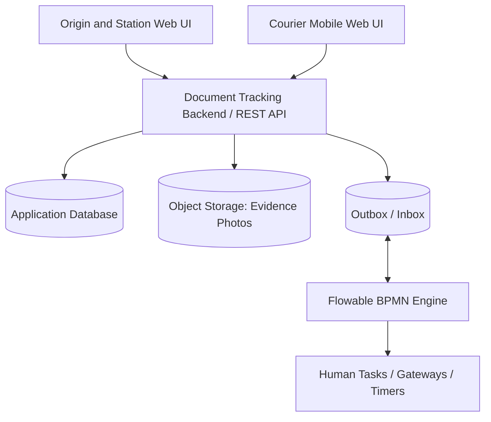
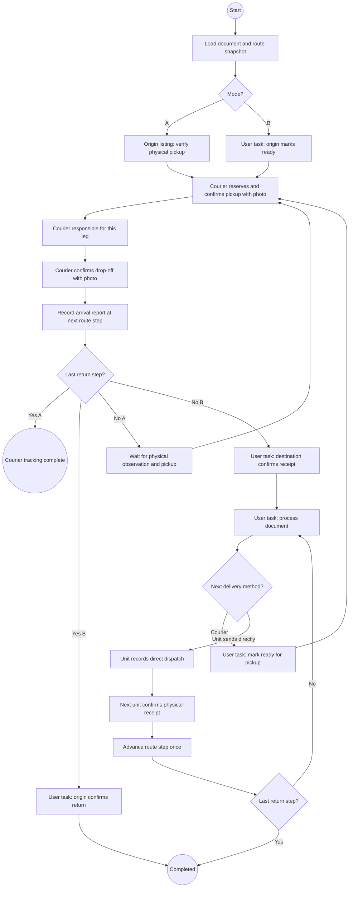

# Document Tracking — Flowable Development Requirements

> **Document ID:** DTR-FLOWABLE-DEV-001  
> **Version:** 1.0-draft  
> **Date:** 2026-11-06 (Asia/Bangkok)  
> **Status:** Proposed technical specification — **not approved for production**  
> **Initial implementation:** Model B first; **Model A must remain executable and tested**  
> **Purpose:** เป็นเอกสารข้อกำหนดการพัฒนาระบบ Document Tracking ที่ใช้ **Flowable BPMN Engine** ควบคุม Workflow และรองรับการเปลี่ยน Model A/Model B โดยไม่ต้องรื้อระบบ

## 0. วิธีอ่านเอกสารและที่มา

เอกสารนี้ต่อยอดจาก `requirements.MD` ฉบับ Business/UX Requirements และชุด Presentation ส่วนหน่วยงาน/ผู้เดินหนังสือ 2 โมเดล จึงแบ่งสถานะข้อกำหนดเป็น:

- **BASELINE:** ข้อกำหนดที่ได้จากการออกแบบ Flow เดิม เช่น ไม่มี QR, Route Template, Check + รูป, ผู้เดินหนังสือรับผิดชอบเป็นช่วง, รับหลายเรื่อง
- **TECHNICAL DESIGN:** แนวทางสถาปัตยกรรมและวิธีทำระบบให้สลับโมเดลได้ เป็นข้อเสนอสำหรับทีมพัฒนา
- **DECISION REQUIRED:** ประเด็นต้องตกลงกับเจ้าของระบบก่อนนำขึ้นใช้งานจริง

**หลักการสำคัญ:** Flowable ช่วยจัดการ *ลำดับงาน/การรอคน/กฎการเดินกระบวนการ* แต่ไม่ควรใช้เป็นฐานข้อมูลทะเบียนหนังสือ, คลังรูปหลักฐาน หรือกลไกป้องกันการรับซ้ำเพียงอย่างเดียว

## 1. เป้าหมายของระบบ

1. ลงทะเบียนหนังสือกระดาษด้วย **เลขหนังสือหรือชื่อเรื่อง** โดยไม่ต้องติด QR Code
2. กำหนดเส้นทาง เช่น `Station A → Station B → Station C → Station A` โดยเลือกจาก Route Template และบันทึกเส้นทางของแต่ละเรื่องเป็น Snapshot
3. ติดตามตำแหน่งที่ยืนยันได้, ผู้เดินหนังสือประจำแต่ละช่วง, สถานะที่รอผู้รับผิดชอบ, เวลา และรูปภาพหลักฐาน
4. ผู้เดินหนังสือแต่ละคนรับผิดชอบ **เฉพาะช่วงที่ Check รับจน Check ส่งสำเร็จ** ไม่ผูกคนเดียวกับเอกสารทั้งเรื่อง
5. รองรับรับ/ส่งหลายเรื่องพร้อมกัน, การจองรับ, การแข่งขันของผู้เดินหนังสือหลายคน, การรับไม่ครบและข้อมูลผิดพลาด
6. ใช้ **Model B เป็นค่าเริ่มต้นของต้นแบบ** แต่รองรับ Model A ด้วย Workflow และ Backend ชุดเดียว
7. เปลี่ยน **ค่าเริ่มต้นของโมเดลสำหรับหนังสือใหม่** ได้ด้วยการตั้งค่า ไม่ต้องแก้โค้ดหลักหรือเปลี่ยนฐานข้อมูล
8. **ไม่เปลี่ยนโมเดลของหนังสือที่กำลังเดินอยู่อัตโนมัติ** เว้นแต่ผ่านกระบวนการย้ายโหมดที่ออกแบบและทดสอบแยกต่างหาก

## 2. นิยาม Model A และ Model B

| เงื่อนไข | MODEL_A | MODEL_B |
|---|---|---|
| ต้นทางลงทะเบียนและกำหนดเส้นทาง | ใช่ | ใช่ |
| ต้นทางกดแจ้งพร้อมจัดส่งก่อนเปิดคิว | ไม่บังคับ | **บังคับ** |
| ผู้เดินหนังสือ Check รับ + ภาพ | บังคับ | บังคับ |
| ผู้เดินหนังสือ Check ส่ง + ภาพ | บังคับ | บังคับ |
| Station ปลายทางกด **ยืนยันรับจริง** | **ไม่มี** | **บังคับ** |
| Station กด **พร้อมจัดส่ง** หลังดำเนินการ | **ไม่มี** | **บังคับ** |
| รู้ว่าหน่วยงานทำงานเสร็จแล้วหรือไม่ | ไม่รู้จากระบบ ต้องตรวจพบเอกสารจริงที่ถาด | รู้จากการกด READY ของหน่วยงาน |
| ผู้เดินหนังสือคนใหม่รับช่วงได้ | เมื่อพบเอกสารจริงและยืนยัน Check รับ | เมื่อหน่วยงานกด READY แล้วเท่านั้น |
| ส่งคืนต้นทาง | รายงาน Check ส่งคืน ถือเป็น **จบการติดตามการนำส่ง** | ต้องรอ **ต้นทางยืนยันรับคืน** ก่อน Completed |
| หน่วยงานส่งต่อเอง | อนุมานได้เฉพาะจุดที่พบภายหลัง และทำเครื่องหมายช่วงไม่มีหลักฐาน | ใช้กระบวนการ `DIRECT_UNIT_TRANSFER` และให้ปลายทางยืนยันรับ |

> **Evidence rule:** การ Check ส่งของผู้เดินหนังสือเป็นเพียงหลักฐานว่า **ผู้เดินหนังสือรายงานการส่ง** ไม่เท่ากับการยืนยันรับของหน่วยงาน

### 2.1 ตัวแปรควบคุมโมเดล

```json
{
  "document_id": "DOC-2026-0001",
  "tracking_mode": "MODEL_B",
  "route_template_id": "TEMPLATE-001",
  "route_template_version": 3,
  "route_snapshot": [
    { "step_id": "S0", "sequence": 0, "station_id": "A", "role": "ORIGIN" },
    { "step_id": "S1", "sequence": 1, "station_id": "B", "role": "PROCESS" },
    { "step_id": "S2", "sequence": 2, "station_id": "C", "role": "PROCESS" },
    { "step_id": "S3", "sequence": 3, "station_id": "A", "role": "RETURN" }
  ],
  "process_definition_key": "document_tracking_v1",
  "process_instance_id": null
}
```

**กฎ:** `tracking_mode` และ `route_snapshot` ต้องถูกกำหนดเมื่อสร้างเรื่องและเป็น Immutable ตามค่าเริ่มต้น; เส้นทางมี A สองครั้งจึงต้องอ้าง `step_id` ไม่ใช่แค่ `station_id`.

## 3. UX/Role ที่ใช้ร่วมกัน

| Role | เมนู/การกระทำที่อนุญาต |
|---|---|
| **Origin Unit** | Dashboard, ลงทะเบียน, Route Template, **หนังสือของหน่วยงาน**, ติดตาม/ดูหลักฐาน, ยืนยันรับคืนใน Model B |
| **Station Staff** | เฉพาะ Model B: ยืนยันรับ, กำลังดำเนินการ, แจ้งพร้อมจัดส่ง, ส่งต่อเอง, รายงานไม่พบ/รับไม่ครบ |
| **Courier** | เลือก Station, งานรับที่มีสิทธิ์, จองรับหลายเรื่อง, Check รับ+รูป, งานกำลังนำส่ง, Check ส่ง+รูป, Timeline |
| **Coordinator/Admin** | มองเห็นตามสิทธิ์ระบบ, ตั้งค่า default mode, จัดการ exception และอนุมัติการแก้เส้นทาง/ย้ายโหมด |

**ข้อจำกัดสิทธิ์:** เมนู **หนังสือของหน่วยงาน** แสดงเฉพาะเรื่องที่หน่วยงานนั้นเป็นต้นทาง ไม่ใช่หนังสือทั้งหมดที่เคยผ่าน Station นั้น; Station Staff ใน Model B มี Worklist รับ/พร้อมจัดส่งแยกต่างหากสำหรับเรื่องที่ต้องทำ แม้ไม่ใช่ต้นเรื่อง

## 4. สถาปัตยกรรมที่เสนอ (TECHNICAL DESIGN)



**หน้าที่ของแต่ละชั้น**

- **Application Backend**: Authentication/Authorization, Route Template, Document Registry, Courier Reservation, Bulk Operations, State Validation, Evidence Files, Audit, API และ event orchestration
- **Flowable BPMN Engine**: รอ Task ของคนที่ถูกต้อง, กำหนดลำดับขั้นตอน, เลือกเงื่อนไข `tracking_mode`, เปิด Task ถัดไป, timeout/escalation, process versioning
- **Application Database**: เก็บข้อมูลทางธุรกิจ/เหตุการณ์ที่เกิดจริงและสถานะที่คำนวณล่าสุด; ไม่อ่านแก้ตารางภายในของ Flowable โดยตรง
- **Object Storage**: เก็บรูปจริงพร้อม metadata และ checksum; ฐานข้อมูลเก็บเพียง reference
- **Outbox/Inbox**: ทำให้การบันทึกธุรกิจและการสั่ง Flowable ประสานกันได้อย่างปลอดภัย แม้คำสั่งส่งซ้ำหรือบริการหยุดชั่วคราว

**แนวทางติดตั้งสำหรับต้นแบบ:** Java + Spring Boot + Flowable Open Source BPMN Engine (Embedded), PostgreSQL, Object Storage แบบ S3-compatible, Frontend เว็บ/มือถือ. ใช้ Service boundary เดียวแบบ Modular Monolith ก่อน; ค่อยแยก Engine เป็นบริการเมื่อมีเหตุผลด้าน Scale/Operations

**ต้องตรวจสอบเวอร์ชันจริงก่อนสร้างโปรเจกต์:** ใช้ Flowable/Spring Boot/Java รุ่นที่ประกาศว่าเข้ากันได้ในคู่มืออย่างเป็นทางการ และ pin dependency ทั้งหมด ห้ามคัดลอกหมายเลขเวอร์ชันจากตัวอย่างโดยไม่ตรวจสอบ

## 5. เจ้าของข้อมูลและหลักฐาน — สำคัญต่อการสลับโมเดล

| ข้อมูล | Source of Truth | ความหมาย |
|---|---|---|
| ทะเบียนหนังสือ, ต้นเรื่อง, เส้นทางที่ตรึงไว้ | Application DB | ธุรกิจหลัก |
| `tracking_mode`, default mode, policy version | Application DB | ข้อกำหนดของเรื่อง/ระบบ |
| ภาพถ่าย, checksum, ประเภทเหตุการณ์ | Object Storage + App DB | หลักฐาน |
| ผู้เดินหนังสือรับผิดชอบช่วง A→B | Application DB | ความรับผิดชอบจริงตาม Check |
| Active User Task และ current BPMN activity | Flowable | Workflow orchestration |
| Timeline สำหรับผู้ใช้ | Application Event Ledger | ประวัติที่ตรวจสอบได้; ไม่แต่งเติมเหตุการณ์ที่ไม่มีหลักฐาน |
| สถานะบนหน้า Dashboard | Projection จาก Event + Workflow | ความหมายของสถานะถูกต้องตามโมเดล |

**ห้าม** บันทึก `UNIT_ACCEPTED` หรือ `UNIT_READY` สำหรับ Model A ด้วยการตั้งค่า default หรือการข้าม Gateway เพื่อทำให้เส้นทางเดินต่อได้ ต้องแสดงว่าไม่มีหลักฐานจากหน่วยงาน

## 6. ออกแบบ Flowable Process กลาง

**Process Definition Key:** `document_tracking_v1`  
**Business Key:** `document_id` ที่ไม่ซ้ำ  
**Strategy:** **หนึ่ง BPMN หลัก** + Gateway/Reusable Subprocess ตาม `tracking_mode`, Process Instance หนึ่งเรื่องต่อหนังสือหนึ่งเรื่อง  
**Route Strategy:** ใช้ Route Snapshot + `route_step_index` เพื่อวนทีละช่วง (ไม่สร้าง BPMN ใหม่ทุก Route Template)

### 6.1 Process Variables ขั้นต่ำ

| Variable | Type | หน้าที่ |
|---|---|---|
| `documentId` | String | รหัสเรื่องภายใน |
| `trackingMode` | Enum `MODEL_A/MODEL_B` | เลือก branch และตรึงตลอด instance |
| `routeStepIndex` | Integer | ขั้นตอนปัจจุบันใน Route Snapshot |
| `currentStationId` | String | Station ที่กำลังรอ/ได้รับการรายงาน |
| `nextStationId` | String | จุดส่งถัดไป |
| `currentLegId` | UUID/String | ช่วงนำส่งปัจจุบัน |
| `deliveryMethod` | Enum `COURIER/DIRECT_UNIT` | รูปแบบการส่งช่วงนี้ |
| `lastEvidenceEventId` | UUID/String | อ้างอิง event ล่าสุดที่ Backend ตรวจสอบแล้ว |
| `workflowPolicyVersion` | String | เวอร์ชันกฎ Workflow |

**หมายเหตุ:** เก็บตัวแปรเท่าที่จำเป็นใน Engine; ข้อมูล Route เต็ม/เอกสาร/หลักฐานให้อ่านจาก Application ผ่าน service ที่มีสิทธิ์ ไม่ควรเก็บข้อมูลส่วนบุคคลหรือ binary ภาพถ่ายลงใน process variables

### 6.2 BPMN หลัก (Logical Flow)



> แผนภาพนี้เป็น **Logical Flow** ไม่ใช่ BPMN 2.0 ที่นำไป deploy ได้ทันที. กรณีส่งต่อเองต้องยืนยันรับที่ปลายทางก่อน advance route step; กรณี Courier ต้องรอยืนยันรับของหน่วยงานใน Model B หลัง Check ส่ง. เมื่อนำไปสร้าง BPMN จริงต้องแยกการวน route step, correlation, exception และเงื่อนไข return receipt ตาม policy อย่างชัดเจน โดยเฉพาะ `DIRECTFINAL` ที่ต้องยืนยันว่าหน่วยงานต้นทางเป็นผู้รับจริงก่อน Completed.

### 6.3 การใช้ Flowable Components

| Component | ใช้กับ | เงื่อนไข |
|---|---|---|
| Start Event | ทั้งสอง | เมื่อ Application สร้างเรื่องสำเร็จ |
| Service Task / Delegate | ทั้งสอง | อ่าน Route Snapshot และคำนวณ next step / สร้าง notification |
| Exclusive Gateway | ทั้งสอง | แยก `MODEL_A/MODEL_B`, final step, direct vs courier |
| User Task — `ORIGIN_READY` | B | ต้นทางกดพร้อมจัดส่ง |
| User Task — `COURIER_PICKUP` | A/B | ผู้มีสิทธิ์จอง/Check รับพร้อมรูป; A แสดงเป็น “ตรวจพบและรับจริง” ไม่ใช่ READY |
| User Task — `COURIER_DROPOFF` | A/B | ผู้ที่เป็นเจ้าของช่วง Check ส่งพร้อมรูป |
| User Task — `UNIT_RECEIVE` | B | Station ปลายทางยืนยันรับ (แยกจาก courier drop-off) |
| User Task — `UNIT_PROCESS_AND_READY` | B | เจ้าหน้าที่กดพร้อมจัดส่งหลังวางเอกสารจริง |
| User Task — `ORIGIN_RETURN_RECEIVE` | B | A ยืนยันรับคืนก่อน Completed |
| Message Catch / Receive Task | A/B | รองรับเหตุการณ์ asynchronous จาก Backend เมื่อจำเป็น; ต้อง correlation ด้วย `documentId` + `stepId` |
| Boundary Timer / Escalation | B เป็นหลัก | งานรับ/พร้อมส่งค้างเกิน policy -> แจ้งเตือน ไม่ auto-accept |
| Error/Exception path | ทั้งสอง | ไม่พบเอกสาร, รับผิด Station, รับไม่ครบ, เกิด conflict |

**กฎการเปิด Task:** ทุก Task ของ Flowable ต้องผ่าน Backend เมื่อกด Complete; Frontend ห้ามเรียก Flowable REST API โดยตรง เพราะ Backend ต้องยืนยันสิทธิ์, รูป, สถานะ, เหตุการณ์ และป้องกันคำสั่งซ้ำก่อน

### 6.4 การวน Route Step

1. `routeStepIndex=0` หมายถึง **ต้นทาง**; `nextStationId` คือ Station ถัดไป
2. Courier รับจาก step ปัจจุบันและส่งไป step ถัดไป; `courier_leg` ถูกปิดเมื่อ `COURIER_DROPOFF` ถูกบันทึกสำเร็จ
3. Increment step **หลังยืนยันเหตุการณ์การมาถึงของ step ถัดไปตามกฎโมเดล** โดยกำหนดกฎอย่างเดียวใน service และทดสอบแยก; **อย่า increment ซ้ำเมื่อ retry**
4. ใน Model B, Courier Drop-off ที่ B ยังไม่ถือว่าหน่วยงานรับจริง; ต้องมี Task `UNIT_RECEIVE` ก่อนเข้าสู่การดำเนินการ
5. ใน Model A, หลัง Drop-off ที่ B ให้รอการพบเอกสารที่จุดรับจริง; **ไม่สร้าง UNIT_READY สมมติ**
6. เมื่อถึง step สุดท้าย A: Model A -> `COURIER_TRACKING_COMPLETE`; Model B -> `ORIGIN_RETURN_RECEIVE` -> `COMPLETED`
7. ถ้าต้องเวียนกลับ Station เดิมระหว่างทาง ให้สร้าง `step_id` คนละตัวและบันทึกรอบจริง; ห้ามใช้แค่ชื่อ Station ในการเทียบขั้นตอน

## 7. Business State / Transition Policy

### 7.1 สถานะร่วมและสถานะเฉพาะโมเดล

| State (API) | A | B | ผู้รับผิดชอบถัดไป/ความหมาย |
|---|---|---|---|
| `REGISTERED` | ✓ | ✓ | เปิดเรื่องแล้ว |
| `WAIT_ORIGIN_READY` | — | ✓ | ต้นทางต้องเตรียมและกด READY |
| `AWAIT_PHYSICAL_PICKUP` | ✓ | — | อยู่ที่ Station ตามรายงานล่าสุด; ยังไม่ยืนยันว่าพร้อมรับ |
| `READY_FOR_PICKUP` | — | ✓ | หน่วยงานกดพร้อมจัดส่งแล้ว |
| `PICKUP_RESERVED` | ✓ | ✓ | จองชั่วคราว ไม่ถือว่ารับแล้ว |
| `IN_TRANSIT` | ✓ | ✓ | Courier Check รับแล้ว |
| `DROPPED_OFF_UNCONFIRMED` | ✓ | — | Courier รายงานส่งถึง Station; ไม่มีการยืนยันของหน่วยงาน |
| `PENDING_UNIT_RECEIPT` | — | ✓ | Courier ส่งถึงแล้ว หน่วยงานยังไม่กดยืนยันรับ |
| `UNIT_PROCESSING` | — | ✓ | หน่วยงานยืนยันรับแล้ว แต่ยังไม่พร้อมส่ง |
| `DIRECT_UNIT_IN_TRANSIT` | — | ✓ | หน่วยงานส่งต่อเอง; ยังไม่ยืนยันปลายทางรับ |
| `PENDING_ORIGIN_RETURN_RECEIPT` | — | ✓ | Courier ส่งกลับต้นทาง รอต้นทางยืนยันรับ |
| `COURIER_TRACKING_COMPLETE` | ✓ | — | ผู้เดินหนังสือรายงานว่าส่งคืนต้นทาง; ไม่ใช่ unit receipt |
| `COMPLETED` | — | ✓ | ต้นทางยืนยันรับคืนแล้ว |
| `EXCEPTION` | ✓ | ✓ | มีเหตุขัดข้อง; ต้องกำหนดวิธีกลับสู่ปกติ |

**หมายเหตุ:** State ที่แสดงเป็น `DROPPED_OFF_UNCONFIRMED` ใน Model A อาจถูกรวมเป็น `AWAIT_PHYSICAL_PICKUP` ใน Read Model ได้ แต่ event จริงต้องยังมีแยก; ห้ามสื่อว่า READY ถ้ายังไม่มีหลักฐาน

### 7.2 Transition Invariants ที่ต้องบังคับที่ Backend

1. `PICKUP_RESERVED` ไม่ใช่ `IN_TRANSIT` จนกว่าจะถ่ายรูปและ Check รับสำเร็จ
2. ในหนึ่งเรื่อง ณ เวลาใดเวลาหนึ่ง มี **active courier leg ได้สูงสุดหนึ่งช่วง** และ active pickup reservation ได้สูงสุดหนึ่งรายการ
3. `COURIER_DROPOFF` ต้องถูกบันทึกโดยผู้รับผิดชอบ leg นั้น หรือผู้ได้รับการส่งมอบงานอย่างถูกต้อง
4. Model B ห้าม Courier Check รับที่ B หากยังไม่มี `READY_FOR_PICKUP` ของ B; Model A ใช้หลักฐานการพบเอกสารจริงแทน READY
5. Model B ห้าม Unit Ready หากยังไม่ `UNIT_RECEIVE` (ยกเว้น origin step แรก ที่ลงทะเบียนแล้วพร้อมส่งได้)
6. หน่วยงานส่งต่อเองกับการจองรับของ Courier เป็น **mutually exclusive** ในเรื่องเดียวกันและ step เดียวกัน
7. `COMPLETED` ของ Model B เกิดได้หลัง unit receipt ที่ step return เท่านั้น
8. Snapshot เส้นทางและ `tracking_mode` ไม่เปลี่ยนเองระหว่างรัน
9. ห้ามสร้างเหตุการณ์การรับ/ส่งของบุคคลที่ไม่ได้ทำรายการจริง
10. ทุกรายการ Check ต้องมี `actor`, `recorded_at`, `station`, `route_step_id`, `evidence_ref` และ Event ID ที่ไม่ซ้ำ

## 8. การ Switch Model A ↔ B

### 8.1 นโยบายระดับระบบ — **รองรับตั้งแต่ต้นแบบ**

`default_tracking_mode` สามารถตั้งเป็น `MODEL_A` หรือ `MODEL_B` ด้วยสิทธิ์ Admin; ค่านี้ใช้ **เฉพาะหนังสือใหม่หลังการเปลี่ยนค่า**

```yaml
workflow_policy:
  default_tracking_mode: MODEL_B
  allow_document_mode_override_on_create: false
  allow_active_instance_mode_switch: false
  require_photo_on_courier_receive: true
  require_photo_on_courier_dropoff: true
  route_change_requires_approval: true
```

**พฤติกรรมบังคับ**

- เมื่อเปลี่ยน `default_tracking_mode` จาก B → A: หนังสือใหม่วิ่ง Model A; หนังสือเก่า Model B ยังต้อง Unit Confirm/Ready ตาม Workflow เดิมจนจบ
- เมื่อเปลี่ยน A → B: หนังสือใหม่ต้อง Unit Ready/Confirm; ไม่เติมหลักฐานหน่วยงานให้เรื่องเก่า
- Dashboard สามารถแสดงทั้งสองโมเดลพร้อมกันโดยมีป้าย `MODEL_A/MODEL_B` ต่อเรื่อง
- ต้องเก็บ `policy_version`, `tracking_mode`, ผู้เปลี่ยน default, เวลาที่มีผล และเหตุผลใน Audit Trail

### 8.2 สลับโมเดลของ **หนังสือที่กำลังเดินอยู่**

**เวอร์ชันต้นแบบ:** ไม่รองรับการสลับแบบ online ให้เปลี่ยนเฉพาะหนังสือใหม่ และปล่อยหนังสือเดิมจบตามโหมดเดิม

**หากเป็น Requirement ใน Production ภายหลัง:** ต้องออกแบบเป็น Admin Migration Workflow แยก มีเงื่อนไขอย่างน้อยดังนี้:

1. ขอเปลี่ยนพร้อมเหตุผลและผู้อนุมัติ
2. ปฏิเสธถ้ามี courier กำลังถือหนังสือ, มี active reservation, มี direct unit transfer ค้าง, หรือมี unit receipt conflict ที่ยังไม่ปิด
3. ทำได้เฉพาะ *safe boundary* ที่กำหนดชัด (เช่น ณ Station หลังสถานะที่ยืนยันแล้วและไม่มีการส่งมอบค้าง)
4. แปลง active BPMN tasks/variables โดย Migration Plan และ Mapping ที่ทดสอบครบ; ไม่ใช้วิธีแก้ `trackingMode` variable ตรง ๆ เพื่อข้าม task
5. ไม่ลบ/ไม่แก้ประวัติและรูปเดิม และไม่สร้าง unit receipt/ready ย้อนหลัง
6. เก็บ audit: from/to mode, process definition version, task migration mapping, approver, reason, effective_at
7. rollback/fallback หาก migration ไม่สำเร็จ ต้องไม่ทำให้ขั้นตอนสูญหาย

**คำเตือน:** การเปลี่ยน `trackingMode` ไม่เหมือน Process Definition Migration ของ Flowable; การเปลี่ยน mode ที่อยู่ระหว่างรันอาจต้องแปลง active tasks และสถานะธุรกิจด้วย จึงไม่ทำอัตโนมัติ

### 8.3 Contract ของ Mode Switch Test

| Test | คาดหวัง |
|---|---|
| B running, Admin เปลี่ยน default เป็น A | B เดิมยังต้องยืนยันรับ/พร้อมจัดส่ง; A ใหม่ไม่บังคับ |
| A running, Admin เปลี่ยน default เป็น B | A เดิมไม่เกิด Task `UNIT_RECEIVE`; B ใหม่ต้องมี |
| มี A และ B พร้อมกัน | ผู้เดินหนังสือเห็นคิวที่ถูกต้องตามแต่ละเรื่อง, ไม่ใช้สถานะ READY ของ A |
| มีรูป Check แล้วสลับ default | รูปและผู้บันทึกไม่เปลี่ยน |
| คลิกเปลี่ยน mode ในเรื่อง active | ปฏิเสธและบอกว่าอนุญาตเฉพาะเรื่องใหม่ |
| Deploy BPMN v2 | Instance เก่ายังใช้เวอร์ชันเดิม เว้นแต่ migrate โดยอนุมัติ |

## 9. Bulk Receive/Send และหลายผู้เดินหนังสือ

- สามารถเลือกหนังสือหลายเรื่องที่ Station เดียวกันเพื่อจองรับได้ แต่ทุกเรื่องต้องผ่าน Guard ของโมเดลตัวเองก่อน
- บันทึก `batch_id` รวมเพื่ออ้างรูปถ่ายชุด แต่ **ต้องสร้าง Event ต่อเรื่อง** และตรวจว่าหนังสือทุกเรื่องถูกเลือก/มีอยู่จริง
- Check ส่งเป็นชุดได้เฉพาะเรื่องที่ไป **Station ปลายทางเดียวกัน**
- การจองพร้อมกันของคน A/B ต้องทำแบบ Atomic ใน DB; คนที่ไม่ได้รับจองต้องได้ `409 CONFLICT` และข้อมูลสถานะล่าสุด
- TTL ของ Reservation ต้องมีนโยบายชัด และคืนคิวเฉพาะงานที่ **ยังไม่ Check รับ**; ห้ามปล่อย `IN_TRANSIT` อัตโนมัติ
- การทำคำสั่งซ้ำต้องใช้ `Idempotency-Key`, unique event constraint และ optimistic version check
- หากบางเรื่องในชุดไม่พร้อม ต้องเลือกนโยบาย `all_or_nothing` หรือ `partial_success` ก่อนใช้งานจริง; **ข้อเสนอเริ่มต้น:** Atomic reservation เฉพาะรายการที่เลือก และแจ้ง conflict รายเรื่องก่อนยืนยัน Check (ไม่เงียบตัดเรื่อง)
- ภาพรวม 1 รูปใช้เป็นหลักฐานของชุดได้แต่ไม่รับรองว่าเห็นเลขหนังสือทุกเรื่อง; หน้าจอต้องให้ตรวจรายชื่อและแนบภาพเพิ่มเมื่อจำเป็น

## 10. Direct Unit Transfer และ Exception Handling

### 10.1 Model B — หน่วยงาน B ส่งต่อเองไป C

1. B ยืนยันรับหนังสือและทำงานเสร็จ
2. B เลือก **`DIRECT_UNIT_TRANSFER`** (ไม่เลือก READY ให้ Courier)
3. Backend ตรวจว่าไม่มี Reservation หรือ Leg ของ Courier ค้างอยู่ใน step นั้น
4. บันทึกผู้ดำเนินการฝั่ง B, `from_station=B`, `to_station=C`, เวลาบันทึก และหลักฐานตาม Policy (รูปเป็น optional หรือ required ต้องตัดสินใจ)
5. Flowable เปิด Task ให้ C **ยืนยันรับ**; ก่อน C ยืนยันรับ สถานะ `DIRECT_UNIT_IN_TRANSIT`/`PENDING_UNIT_RECEIPT` ไม่ถือว่า C รับแล้ว
6. C ยืนยันรับ → เข้า `UNIT_PROCESSING` ของ C
7. กรณี C ปฏิเสธรับ ให้เปิด Exception; ห้ามสร้างการยืนยันรับปลอม

### 10.2 Model A — พบหนังสือข้าม Station

- เมื่อประวัติล่าสุดแสดง B แต่ผู้เดินหนังสือพบที่ C ให้ใช้ `OBSERVED_AT` พร้อม `station=C`, รูป และเวลาที่พบจริง
- เพิ่ม `UNOBSERVED_TRANSFER` เพื่อแสดงว่าช่วง B→C **ไม่มีหลักฐานว่าใครนำส่งและเวลาใด**
- ต้องตรวจว่าจุด C เป็นจุดใน Route ที่อนุญาตให้ reconciliate หรือไม่; ถ้าไม่ใช่ ให้เปิด Exception และรอผู้ดูแลยืนยัน
- หลังยืนยัน observation ที่ C แล้วจึง Check รับเพื่อไป step ถัดไป โดยไม่ลบประวัติ B

### 10.3 ข้อยกเว้นขั้นต่ำ

| Code | เหตุการณ์ | แนวทางจัดการ |
|---|---|---|
| `DOCUMENT_NOT_FOUND` | หน่วยงาน/ผู้เดินหนังสือไม่พบหนังสือ | เปิด Case แทนการกดรับ |
| `PARTIAL_BATCH_RECEIPT` | รับไม่ครบชุด | ยืนยันแยกต่อเรื่อง; เรื่องที่ขาดเปิด Case |
| `WRONG_STATION` | พบหรือส่งผิดจุด | บันทึกจุดที่พบจริง, ตรวจสิทธิ์ และจัดการ Route Exception |
| `RECEIPT_DISPUTE` | Courier รายงานส่งแล้ว แต่หน่วยงาน B ไม่ยืนยัน | คงสถานะรอ/มีข้อโต้แย้ง; ไม่ auto-accept |
| `DUPLICATE_ACTION` | กดซ้ำ/Retry | คืนผลเดิมเมื่อ Idempotency Key เดิม |
| `MID_LEG_HANDOFF` | เปลี่ยน Courier ก่อนถึงปลายทาง | ต้องมี Flow ส่งมอบระหว่างบุคคลพร้อมหลักฐานทั้งสองฝ่าย |
| `ROUTE_CHANGE` | ขอเปลี่ยนลำดับจุด | ขออนุมัติ, version route snapshot, เก็บ history |

## 11. API Contract ขั้นต่ำ (Proposed Application API)

> Endpoint ด้านล่างเป็น API ของ **Document Tracking Backend** ไม่ใช่ URL ของ Flowable REST โดยตรง. ต้องใช้ Authentication/Authorization และ Idempotency ตามประเภทคำสั่ง

| Method | Endpoint | หน้าที่ | Role |
|---|---|---|---|
| `POST` | `/api/v1/documents` | ลงทะเบียน + Snapshot Route + start workflow | Origin |
| `GET` | `/api/v1/documents?scope=origin` | หนังสือของหน่วยงาน | Origin |
| `GET` | `/api/v1/documents/{id}` | รายละเอียด, สถานะและโมเดล | Authorized role |
| `GET` | `/api/v1/documents/{id}/timeline` | Timeline รวม Event/Task และรูป | Authorized role |
| `POST` | `/api/v1/route-templates` | สร้างแม่แบบ | Origin |
| `GET` | `/api/v1/route-templates` | เลือกแม่แบบที่มีสิทธิ์ | Origin |
| `PUT` | `/api/v1/route-templates/{id}` | แก้แม่แบบเวอร์ชันใหม่ | Origin |
| `POST` | `/api/v1/documents/{id}/ready` | ต้นทาง/Station กด READY | Unit (B only) |
| `GET` | `/api/v1/stations/{id}/worklist` | งานของ Station ตามโมเดล | Unit/Courier scoped |
| `POST` | `/api/v1/courier/reservations` | จองหนังสือหลายเรื่อง | Courier |
| `DELETE` | `/api/v1/courier/reservations/{id}` | ยกเลิกจองที่ยังไม่รับ | Owner/Admin |
| `POST` | `/api/v1/courier/check-receive` | Check รับพร้อมหลักฐาน | Courier |
| `POST` | `/api/v1/courier/check-dropoff` | Check ส่งพร้อมหลักฐาน | Courier |
| `POST` | `/api/v1/stations/{id}/confirm-receipt` | หน่วยงานยืนยันรับ | Unit (B only) |
| `POST` | `/api/v1/stations/{id}/direct-transfer` | หน่วยงานส่งเอง | Unit (B only) |
| `POST` | `/api/v1/documents/{id}/confirm-return` | ต้นทางยืนยันรับคืน | Origin (B only) |
| `POST` | `/api/v1/documents/{id}/observations` | พบหนังสือผิดจากตำแหน่งล่าสุด | Courier/Admin (A policy) |
| `GET` | `/api/v1/admin/workflow-policy` | ดู default mode | Admin |
| `PUT` | `/api/v1/admin/workflow-policy` | เปลี่ยน default mode **เฉพาะหนังสือใหม่** | Admin |
| `GET` | `/api/v1/admin/exceptions` | ดูงานติดขัด/ข้อโต้แย้ง | Admin/Coordinator |

**ผลตอบกลับขั้นต่ำของ Command:** `operation_id`, `document_ids`, `accepted/rejected`, `event_ids`, `updated_states`, `process_sync_status` (`APPLIED/PENDING/FAILED_RETRYABLE`), `correlation_id` และ error รายเรื่องเมื่อเป็น Bulk

**HTTP status ที่เสนอ:** `200/201` สำเร็จ, `202` รอ Workflow sync, `400` input ไม่ถูกต้อง, `403` ไม่มีสิทธิ์, `404` ไม่พบหรือไม่อยู่ในขอบเขตที่เข้าถึงได้, `409` จองซ้ำหรือสถานะเปลี่ยน, `422` ไม่ผ่านกติกาของโมเดล

### 11.1 ตัวอย่างคำสั่ง Check รับเป็นชุด

```http
POST /api/v1/courier/check-receive
Idempotency-Key: 6b7658d6-6cba-4f1e-bd74-36fedab4a304
Content-Type: application/json
```

```json
{
  "reservation_id": "RES-001",
  "station_id": "B",
  "items": [
    { "document_id": "DOC-001", "route_step_id": "S1" },
    { "document_id": "DOC-002", "route_step_id": "S1" }
  ],
  "evidence_upload_id": "PHOTO-UPLOAD-001"
}
```

Backend ต้องตรวจว่าผู้ส่งคำขอเป็นผู้จองงานนั้น, รูปถูกอัปโหลดผ่านระบบที่ตรวจไฟล์แล้ว, ทุกรายการอยู่ที่ Station/step ที่ถูกต้อง และไม่มี leg อื่นที่ active ก่อนยืนยัน Check

### 11.2 Domain Event ที่ส่งให้ Flowable

```json
{
  "event_id": "EVT-001",
  "event_type": "COURIER_PICKED_UP",
  "document_id": "DOC-001",
  "route_step_id": "S1",
  "tracking_mode": "MODEL_B",
  "actor_id": "USR-COURIER-02",
  "occurred_at_utc": "2026-11-06T03:00:00Z",
  "recorded_at_utc": "2026-11-06T03:00:01Z",
  "evidence_ids": ["EVD-001"],
  "correlation_id": "OP-001"
}
```

Event ที่ควรใช้: `DOCUMENT_REGISTERED`, `UNIT_READY`, `COURIER_PICKED_UP`, `COURIER_DROPPED_OFF`, `UNIT_RECEIPT_CONFIRMED`, `ORIGIN_RETURN_CONFIRMED`, `DIRECT_UNIT_DISPATCHED`, `OBSERVED_AT`, `EXCEPTION_OPENED`, `EXCEPTION_RESOLVED`

## 12. การประสานธุรกรรมระหว่าง Backend กับ Flowable

### 12.1 รูปแบบที่ต้องใช้

1. Frontend ส่งคำสั่งมาที่ Backend
2. Backend ตรวจสิทธิ์/สถานะ/Photo และล็อก Transaction สำหรับเอกสารในคำสั่ง
3. บันทึก Domain Event และ Outbox Record ใน Transaction เดียวกัน
4. Commit Transaction แล้วจึงให้ Outbox Worker ส่งสัญญาณ/Complete Task ไป Flowable
5. Flowable ตอบผล; Worker บันทึก Inbox/Acknowledgement และปรับ Projection ที่เกี่ยวข้องแบบ Idempotent
6. ถ้าระบบล่มหลัง Commit แต่ก่อน Flowable รับ Event ให้ retry ได้โดยไม่สร้างเหตุการณ์ Check ซ้ำ

**ห้าม** ออกแบบให้ Frontend กด Complete Task ใน Flowable ก่อน แล้วค่อยพยายามบันทึกรูป/หลักฐาน เพราะอาจทำให้ Workflow เดินต่อทั้งที่หลักฐานบันทึกไม่สำเร็จ

### 12.2 ข้อกำหนดการกู้คืน

- Outbox Worker รองรับ retry/backoff, dead-letter และหน้าดูรายการ sync ไม่สำเร็จ
- แยก `business_state` จาก `process_sync_status`; ถ้า Flowable ยังไม่ sync ห้ามนำ UI ไปแสดงสถานะใหม่ที่ไม่ตรงกันโดยไม่มี indicator
- มี reconciliation job เปรียบเทียบ App Event Ledger กับ Flowable active tasks และแจ้ง Admin เมื่อไม่สอดคล้อง
- มี Correlation Key ที่รวม `documentId + routeStepId + actionType` เพื่อกัน message ไปผิดขั้นตอน; worker ต้องตรวจว่า subscription/task ยังตรงกับ step ปัจจุบัน
- สำหรับการใช้ Embedded Engine และ DB เดียวกัน สามารถพิจารณา Spring Transaction ที่ออกแบบอย่างถูกต้องแทน Outbox บางขั้นตอน แต่ต้องพิสูจน์ atomicity ด้วย integration test; เอกสารนี้ตั้งค่าเริ่มต้นแบบ Outbox เพื่อความชัดเจนและรองรับการแยกบริการภายหลัง

## 13. Data Model เชิงแนวคิด (ไม่ใช่ ER Diagram)

- `documents`: document_id, origin_unit_id, document_number?, title?, tracking_mode, policy_version, status, process_instance_id, created_at
- `route_templates`, `route_template_versions`, `document_route_steps`: template management และ snapshot เส้นทางรายเรื่อง
- `stations`, `users`, `user_station_permissions`: หน่วยงาน/สิทธิ์
- `courier_legs`: from_step/to_step, courier_id, pickup/dropoff timestamps, status
- `pickup_reservations`, `pickup_reservation_items`: การจองและหมดอายุ
- `tracking_events`: append-only events, evidence_type, actor, station, step, server time, correlation
- `evidence_files`, `evidence_event_links`: รูปหลักฐานและการอ้างร่วมใน batch
- `document_exceptions`: กรณีผิดปกติ
- `workflow_policies`, `workflow_mode_change_audits`: default mode และประวัติการเปลี่ยน
- `integration_outbox`, `integration_inbox`: ความสอดคล้องระหว่าง Backend กับ Flowable

**ข้อเสนอเรื่อง ID:** ใช้ Internal UUID เป็นตัวอ้างอิงหลัก เพราะบางเรื่องไม่มีเลขหนังสือและเลขหนังสืออาจซ้ำข้ามหน่วยงาน/ปี; Unique Rule ของเลขหนังสือเชิงธุรกิจต้องตกลงภายหลัง

## 14. Non-functional / Security Requirements

1. ทุก API ต้องตรวจ Authentication/Authorization ฝั่ง Server; ไม่ใช้เพียงการซ่อนเมนู
2. หน่วยงานต้นทางดูหนังสือของตน; Station B/C ใน Model B ดูเฉพาะ Task ที่ตนต้องดำเนินการ; Courier ดูเฉพาะ Station ที่ได้รับสิทธิ์และ leg ของตน; Admin จำกัดตามนโยบายองค์กร
3. รูปหลักฐานเก็บนอก public web root; เข้าถึงผ่าน signed URL อายุสั้น/authorized endpoint; มี checksum, validation MIME/extension/size, malware scan ตามความเสี่ยง
4. เวลาใน DB ใช้ UTC พร้อม `recorded_at` จาก Server; หน้า UI แสดง Asia/Bangkok; ถ้ารองรับ Offline ให้แยก `observed_at` ที่อุปกรณ์ส่งมาและ `recorded_at`
5. Audit Event แบบ append-only, เก็บ actor, evidence และ policy version; การแก้ข้อมูลใช้ correction event ไม่เขียนทับประวัติเดิม
6. การเก็บ/ลบรูปและข้อมูลผู้ใช้ต้องตกลง retention, นโยบายความเป็นส่วนตัว และกฎหมายที่เกี่ยวข้องกับหน่วยงาน
7. มี logging/metrics/trace สำหรับคำสั่ง Check, Outbox, Flowable process id, Task id และ failures โดยไม่บันทึกข้อมูลอ่อนไหวเกินจำเป็น
8. ต้องรองรับการสูญเสียเครือข่ายและการ Retry โดยไม่ Check ซ้ำ; **MVP online-only** และไม่รับประกัน offline commit จนกว่าจะออกแบบเพิ่ม
9. Backup/restore ทั้ง Application DB, Flowable DB/Schema และ Object Storage พร้อมทดสอบการกู้คืน
10. ปริมาณการใช้งาน, SLA, latency, storage sizing และ retention ต้องเก็บ Requirement จริงจากผู้ใช้งานก่อนประเมินการ Deploy

## 15. Testing & Acceptance Gates

| ID | ทดสอบ | ผลที่ต้องผ่าน |
|---|---|---|
| `T01` | Model B: A ลงทะเบียน | คิว Courier ยังไม่ปรากฏก่อน A READY |
| `T02` | Model B: A READY -> Courier 1 รับ/ส่ง B | มีรูป, leg A→B ปิด, B เห็น Task ยืนยันรับ |
| `T03` | Model B: B ยังไม่รับ | Courier 2 ห้าม Check รับจาก B |
| `T04` | Model B: B ยืนยันรับ แต่ยังไม่ READY | Courier 2 ห้าม Check รับจาก B |
| `T05` | Model B: B READY -> Courier 2 รับ/ส่ง C | มี leg ใหม่ B→C โดยไม่ต้องให้คนที่ 1 โอน |
| `T06` | Model B: Courier 3 คืน A | ไม่ Completed จน A ยืนยันรับคืน |
| `T07` | Model A: A ลงทะเบียน -> Courier รับ | A ไม่ต้อง READY; ต้องยืนยันพบเอกสารจริงและรูป |
| `T08` | Model A: Courier ส่ง B | ไม่มี `UNIT_RECEIPT_CONFIRMED` หรือ `UNIT_READY` สมมติ |
| `T09` | Model A: คนใหม่รับที่ B | ทำได้เมื่อพบเอกสารจริงที่ถาดและ Check รับ |
| `T10` | Model A: B ส่งเองถึง C | เกิด `OBSERVED_AT` ที่ C และ `UNOBSERVED_TRANSFER`; ไม่เดา actor/time ของ B→C |
| `T11` | ผู้เดินหนังสือ 2 คนจองพร้อมกัน | มีผู้ได้ Reservation เพียงคนเดียวต่อเรื่อง/ช่วง |
| `T12` | Check รับซ้ำ Retry เดิม | Event ไม่ซ้ำ, ได้ผลลัพธ์เดิม |
| `T13` | Bulk 10 เรื่อง มี 2 conflict | แจ้ง conflict ชัด; ไม่ Check แบบเงียบโดยไม่เลือกใหม่ |
| `T14` | ส่งหลายเรื่องคนละปลายทาง | ต้องแยก Check ส่งตามปลายทางจริง |
| `T15` | Model B: B ส่งเอง | ไม่ชนกับ Courier Reservation; C ยืนยันรับได้ |
| `T16` | Model B: B ส่งเองแต่ Courier จองแล้ว | ห้ามเข้าสองช่องทางพร้อมกัน; ต้อง cancel/resolve ก่อน |
| `T17` | เปลี่ยน default B→A ระหว่างมี B active | B เดิมไม่เปลี่ยน; เรื่องใหม่ใช้ A |
| `T18` | เปลี่ยน default A→B ระหว่างมี A active | A เดิมไม่เปลี่ยน; เรื่องใหม่ใช้ B |
| `T19` | เปลี่ยน Route Template ที่ถูกใช้งานแล้ว | Route Snapshot ของเรื่องเก่าไม่เปลี่ยน |
| `T20` | Outbox Event ส่งซ้ำ / Worker Restart | Flowable ไม่ Complete/เดิน step ซ้ำ |
| `T21` | รูป upload ล้มเหลว | Check ไม่สำเร็จและไม่ Complete Task |
| `T22` | หน่วยงาน B ปฏิเสธว่าได้รับ | ไม่สร้าง unit receipt; เปิด exception |
| `T23` | สลับผู้ใช้ Courier กลาง leg | คนที่ไม่ใช่เจ้าของ leg Check ส่งไม่ได้ |
| `T24` | ไม่ใช่ต้นทางเข้าดู “หนังสือของหน่วยงาน” | ไม่เห็นเรื่องที่ไม่มีสิทธิ์ |
| `T25` | Route A→B→C→A | step สุดท้าย A ไม่สับสนกับ step แรก A |
| `T26` | BPMN deploy เวอร์ชันใหม่ | Instance เก่าคง process definition เดิมจนกว่าจะ migration ที่ได้รับอนุมัติ |

**Gate สำหรับ Proof of Concept (POC):** ต้องผ่าน `T01–T09`, `T11–T12`, `T17–T19`, `T21`, `T25` ก่อนสาธิตสองโมเดล; ก่อน Pilot จริงต้องผ่านทุกกรณีที่อยู่ใน scope ที่หน่วยงานอนุมัติ

## 16. Implementation Roadmap แบบทำทีละโมดูล

| Phase | เป้าหมาย / ผลส่งมอบ | Gate |
|---|---|---|
| `P0` | ตรึง Business Rules, Mode Policy, นิยาม Completed และสิทธิ์ | เจ้าของระบบอนุมัติรายการ Open Decisions |
| `P1` | Application Skeleton: Auth, Station, Document, Template, Snapshot, Evidence | สร้างหนังสือ + ดูข้อมูลได้ |
| `P2` | Flowable BPMN `document_tracking_v1`: branch A/B, route iterator, human tasks, versioning | Unit/Integration Tests BPMN ผ่าน |
| `P3` | Model B end-to-end A→B→C→A ทั้งหน่วยงานและ Courier | Happy path + receipt/ready guards ผ่าน |
| `P4` | เปิด Model A branch + physical pickup semantics + wrong-station observation | A happy path + ไม่มี fake event |
| `P5` | Bulk, reservation, multi-courier, direct transfer, exception | Concurrency/duplicate/conflict tests ผ่าน |
| `P6` | Admin default switch A/B, Audit, reconciliation, deploy/recovery | Active instances ไม่กระทบ + restore test ผ่าน |
| `P7` | UX review/pilot กับผู้ใช้จริง, tuning, reporting | UAT sign-off แยกตามโมเดล |

**ห้าม** ตีความว่า Gateway เดียวจะทำให้ Model A สำเร็จโดยอัตโนมัติ: ต้องพัฒนาและทดสอบ Branch A จริงตั้งแต่ P2/P4 ไม่ใช่ค่อยแก้หลังเจ้าของระบบเปลี่ยนใจ

## 17. Decisions ที่ต้องให้เจ้าของระบบยืนยัน

| ID | คำถาม | ข้อเสนอเริ่มต้น |
|---|---|---|
| `D01` | ใช้ Model ไหนเป็น default เมื่อ Go-Live | เริ่ม `MODEL_B` แต่ตั้งค่าได้ |
| `D02` | ให้เจ้าหน้าที่ต้นทางเลือก Mode เป็นรายเรื่องได้หรือไม่ | **ไม่เปิด** สำหรับ MVP; Admin เลือก default |
| `D03` | เปลี่ยน Mode ระหว่างเรื่องกำลังเดินได้หรือไม่ | **ไม่เปิด** ใน MVP |
| `D04` | Model A จะใช้คำว่า "เสร็จสิ้น" หรือไม่ | แสดง `COURIER_TRACKING_COMPLETE` แยกจาก Model B `COMPLETED` |
| `D05` | Model B รับคืนต้นทางต้องกดยืนยันหรือไม่ | **ต้องกด** เพื่อปิดเรื่อง |
| `D06` | หน่วยงาน B ส่งต่อเองต้องมีรูปหลักฐานด้วยหรือไม่ | กำหนดตามประเภทเอกสาร/นโยบาย |
| `D07` | ระยะเวลาหมดอายุ Reservation | กำหนดหลังทดลองเวลาเดินจริง; หมดอายุได้เฉพาะก่อน Check รับ |
| `D08` | รับบางส่วนใน Bulk | อนุญาตแบบรายการต่อเรื่อง พร้อมแสดง conflict และกดยืนยันใหม่ |
| `D09` | หากผู้เดินหนังสือส่งถึง B แต่ B ไม่ยืนยันรับ | ค้าง `PENDING_UNIT_RECEIPT` และเปิดแจ้งเตือน/ข้อโต้แย้ง |
| `D10` | ใครแก้ Route ของเรื่องที่กำลังเดิน | Admin/Coordinator ตามขั้นอนุมัติและ audit |
| `D11` | สิทธิ์เห็นหนังสือ/รูปของหน่วยงานอื่น | Origin-only list; Station B เฉพาะ worklist ที่เกี่ยวข้อง |
| `D12` | เวลาค้างเพื่อแจ้งเตือนและ SLA | ยังไม่กำหนด ต้องเก็บจากผู้ใช้งาน |
| `D13` | มีเอกสารลับ/อ่อนไหวหรือไม่ | ต้องจำแนกและปิดการเห็นรูป/เรื่องตามสิทธิ์ |
| `D14` | รองรับ Offline ของ Courier ตั้งแต่ MVP หรือไม่ | เริ่ม online-only |
| `D15` | ทำ Receipt แบบจับคู่รูป/เลขหนังสืออย่างไร | ชื่อเรื่อง+เลขหนังสือ+รายการ Check, ไม่ต้อง QR |

## 18. สิ่งที่ไม่อยู่ในขอบเขต MVP

- ระบบสารบรรณอิเล็กทรอนิกส์เต็มรูปแบบ, อนุมัติเนื้อหาเอกสาร, Digital Signature
- OCR/AI ระบุตัวเอกสาร, RFID, GPS proof แบบบังคับ
- การย้าย Mode ของ Process Instance ที่ Active โดยอัตโนมัติ
- การแก้ไข Process/Route ขณะเอกสารกำลังเดินแบบไม่มีผู้อนุมัติ
- Distributed Microservices หรือระบบ Queue ขนาดใหญ่ (ใช้เมื่อวัด Load แล้วจำเป็น)

## 19. Flowable References (Official)

1. Flowable Open Source — Spring Boot Integration: https://www.flowable.com/open-source/docs/bpmn/ch05a-Spring-Boot
2. Flowable Open Source — BPMN Constructs (Tasks, Gateways, Events): https://www.flowable.com/open-source/docs/bpmn/ch07b-BPMN-Constructs
3. Flowable Open Source — Process Engine API: https://www.flowable.com/open-source/docs/bpmn/ch04-API/
4. Flowable Open Source — REST API: https://www.flowable.com/open-source/docs/bpmn/ch14-REST
5. Flowable Open Source — Process Instance Migration: https://www.flowable.com/open-source/docs/bpmn/ch08-ProcessInstanceMigration
6. Flowable Enterprise — Process Definition Version and Migration Concept (Enterprise UI features may differ from OSS): https://documentation.flowable.com/latest/user/hub/migration

> **Final acceptance note:** เอกสารนี้เป็น Development Specification ที่เสนอสำหรับทำ Prototype/Pilot ไม่ใช่การอนุมัติใช้จริง. ต้อง Review รายการ `DECISION REQUIRED`, Validate BPMN in Flowable รุ่นที่เลือก และทดสอบทั้ง `MODEL_A` และ `MODEL_B` ก่อนสาธิตระบบจริง
